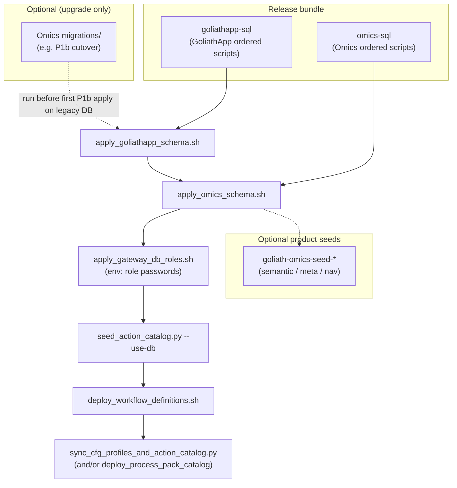

# Populating the PostgreSQL database (GoliathApp + GoliathOmics)

This guide explains **how to apply and populate** the workflow database for GoliathOmics: which SQL and scripts belong to **GoliathApp** (platform), which belong to **Omics** (genomics product), and the **order** in which they run. It focuses on **checked-in** scripts and **PostgreSQL / psql**; it does not replace GoliathApp’s own platform adoption docs (see [Cross-links](#cross-links)).

**Scope boundaries**

- **GoliathApp** owns portal shell, engine DDL (`wf`), RBAC/session procedures, cfg repository APIs, semantic registry tables, and the **per-release** `workflow_engine/sql_pg` ordered bundle. Omics does **not** copy or redefine that framework here.
- **GoliathOmics** owns clinical/domain DDL under `database/schema/`, genomics cfg seeds (analytes, profiles), ActionSpec registration for omics handlers, DomainProgram deployment, and operator SQL such as [`workflow_engine/sql_pg/enqueue_sample_prep_test_start.sql`](../../workflow_engine/sql_pg/enqueue_sample_prep_test_start.sql) for test study starts ([Start a SamplePrep instance](../operators/start-sample-prep.md)).
- **Workers** use the gateway; they do not open raw database connections. Only **admin** roles (or automation running deploy/schema scripts) should run the steps below.

---

## App pin vs Omics pin (they are not the same commit)

A production-shaped database must be consistent with **one MethylPipeline / GoliathOmics release**, which carries two versioned bundles:

| Bundle | Source | Recorded in DB |
|--------|--------|----------------|
| **goliathapp-sql** | GoliathApp `workflow_engine/sql_pg` at build time | `wf.schema_release.goliathapp_sha` (via [`scripts/apply_goliathapp_schema.sh`](../../scripts/apply_goliathapp_schema.sh)) |
| **omics-sql** | This repo `workflow_engine/sql_pg` (order from `apply_schema.sh`) | `wf.omics_schema_release.omics_sha` (via [`scripts/apply_omics_schema.sh`](../../scripts/apply_omics_schema.sh)) |

The **default GoliathApp git pin** for building the gateway wheel and SQL bundle locally is `GOLIATH_APP_REF` in [`scripts/build_gateway_wheel.sh`](../../scripts/build_gateway_wheel.sh). That default is a **convenience for builds**; your **release** may have been built with a different SHA. **Always** read `goliathapp-sql/source.json` and `omics-sql/source.json` inside the unpacked release (or CI artifact) and compare to `wf.schema_release` / `wf.omics_schema_release`. The platform `main` branch and the pin bundled into your release are **not** guaranteed to match.

**Compatibility rule:** Apply **exactly** the `goliathapp-sql` and `omics-sql` directories that shipped with **the same** release tree you intend to run (same `manifest.json` version). Mixing App `main` with an older Omics release (or the reverse) is unsupported and will break FKs, procedures, or catalog rows.

---

## Conceptual layers: schema vs reference data vs runtime

| Layer | What it is | Examples |
|-------|------------|----------|
| **Platform + domain DDL** | `CREATE SCHEMA`, tables, types, `portal.sp_*` shells | GoliathApp bundle → Omics `database/schema/*.sql` (via bundle order) |
| **One-time migrations** | Upgrade paths **not** in the default apply list | [`workflow_engine/sql_pg/migrations/`](../../workflow_engine/sql_pg/migrations/) (run only when preconditions match) |
| **Reference config (cfg)** | Analytes, pipeline profiles, assay procedures | [`scripts/sync_cfg_profiles_and_action_catalog.py`](../../scripts/sync_cfg_profiles_and_action_catalog.py), [`scripts/deploy_process_pack_catalog.sh`](../../scripts/deploy_process_pack_catalog.sh) |
| **Action catalog + workflows** | `wf.workflow_action`, graphs | [`workflow_engine/sql_pg/seed_action_catalog.py`](../../workflow_engine/sql_pg/seed_action_catalog.py), [`scripts/deploy_workflow_definitions.sh`](../../scripts/deploy_workflow_definitions.sh) |
| **Semantic / Meta / Nav (when used)** | Registry rows, Meta classes, nav tree | `goliath-omics-seed-*` CLIs ([semantic layer](semantic-layer.md)) |
| **Tenant / org / admin** | Organizations, roles, gateway passwords | GoliathApp DDL + [`scripts/apply_gateway_db_roles.sh`](../../scripts/apply_gateway_db_roles.sh); portal provisioning is platform-specific |
| **Demo / test-bed** | Synthetic wf rows, test token fixture | [`workflow_engine/sql_pg/deploy_test_bed.sh`](../../workflow_engine/sql_pg/deploy_test_bed.sh) (guardrails; not production) |
| **Operational study data** | Studies, samples, queue rows | Normal portal/API paths; **test study enqueue** uses SQL in Omics ([study start SQL](#study-start-request-queue-omics-sql)) |

---

## End-to-end order (target state)

The production deploy path runs **schema apply** (ledgered, once per release), then **role passwords**, then **catalog sync**, then **workflow definition deploy**. The diagram matches [`docs/architecture/semantic-layer.md`](semantic-layer.md).



**Idempotency:** `apply_goliathapp_schema.sh` and `apply_omics_schema.sh` record releases in `wf.schema_release` and `wf.omics_schema_release`. Re-running the **same** release is a **no-op** unless you pass `--force` / `GOLIATH_SCHEMA_FORCE` (see scripts’ help). Failed applies roll back the **whole** transaction and do **not** record the release.

---

## Prerequisites

### Tooling

- **PostgreSQL** server (supported version per release notes) and **psql** client.
- **jq** (required by the apply scripts for `manifest.json` / bundle metadata).
- Python **3** with repo venv when running seed/sync/deploy scripts (see individual script headers).

### Extensions and privileges

- Omics Meta-related DDL may require **`pgcrypto`** (`CREATE EXTENSION IF NOT EXISTS pgcrypto;` appears in domain scripts — see `database/schema/10_omics_meta_clinical_classes.sql`).
- Schema apply typically runs as a **database owner** or superuser. Least-privilege **`goliath_gateway`** / **`goliath_portal`** roles are created in GoliathApp’s `database_gateway_roles.sql` and are meant for **runtime** services, not for applying DDL ([semantic layer](semantic-layer.md#database-roles-goliath_portal-and-goliath_gateway)).

### Environment variables (names only)

Scripts use **libpq** conventions: `PGHOST`, `PGPORT`, `PGDATABASE`, `PGUSER`, `PGPASSWORD`, `PGSSLMODE` (never log values). Gateway-oriented tools may use `GOLIATH_DATABASE_URL` / `WF_DATABASE_URL` ([GoliathApp extension](../goliathapp-extension.md)).

---

## Path A — Release-shaped apply (recommended for “what production does”)

Use the **`goliathapp-sql/`** and **`omics-sql/`** trees that ship inside an unpacked MethylPipeline release (or a directory built by [`scripts/bundle_goliathapp_sql.py`](../../scripts/bundle_goliathapp_sql.py) / [`scripts/bundle_omics_sql.py`](../../scripts/bundle_omics_sql.py) at known SHAs).

1. **Optional:** On a database **upgraded from pre-P1b**, run the **one-time** migration [`workflow_engine/sql_pg/migrations/20261023_semantic_p1b_organization_cutover.sql`](../../workflow_engine/sql_pg/migrations/20261023_semantic_p1b_organization_cutover.sql) **before** the first P1b-aligned apply (see [Semantic layer — organization tenancy](semantic-layer.md#organization-tenancy-p1b)). Greenfield databases skip this.

2. Apply **GoliathApp** bundle (single transaction, advisory lock, `ON_ERROR_STOP` inside the script):

   ```bash
   export PGHOST=... PGPORT=5432 PGDATABASE=GoliathOmics PGUSER=... PGPASSWORD=...
   bash scripts/apply_goliathapp_schema.sh --release-dir /path/to/unpacked/release
   ```

3. Apply **Omics** bundle:

   ```bash
   bash scripts/apply_omics_schema.sh --release-dir /path/to/unpacked/release
   ```

4. Set gateway/portal role passwords (**if** your environment uses `goliath_gateway` / `goliath_portal`). [`scripts/apply_gateway_db_roles.sh`](../../scripts/apply_gateway_db_roles.sh) requires `PGHOST`, `PGDATABASE`, `PGUSER`, `PGPASSWORD` **and** at least one of `GOLIATH_GATEWAY_DB_PASSWORD`, `GOLIATH_PORTAL_DB_PASSWORD` (values come from your secret store; never commit them):

   ```bash
   export PGHOST=... PGDATABASE=... PGUSER=...
   export PGPASSWORD=...   # admin connection used only for ALTER ROLE
   export GOLIATH_GATEWAY_DB_PASSWORD=...   # new password for role goliath_gateway
   export GOLIATH_PORTAL_DB_PASSWORD=...      # optional second role
   bash scripts/apply_gateway_db_roles.sh
   ```

5. **Seed ActionSpec + runtime dispatch**, then **deploy workflow graphs**:

   ```bash
   python workflow_engine/sql_pg/seed_action_catalog.py --use-db
   bash scripts/deploy_workflow_definitions.sh
   ```

6. **Cfg / process-pack reference data** (analytes, profiles, procedures) — typical sequence:

   ```bash
   bash scripts/deploy_process_pack_catalog.sh --backend postgres --sync
   ```

   For `--sync`-only or advanced cases, see [Config registry](../usage/19-config-registry.md) and [`scripts/sync_cfg_profiles_and_action_catalog.py`](../../scripts/sync_cfg_profiles_and_action_catalog.py).

7. **Optional** semantic / Meta / Nav seeds (only if your environment uses those features; see [Semantic layer](semantic-layer.md)).

**Verify ledgers** after step 3 (and optionally compare SHAs to `source.json` files):

   ```bash
   psql -v ON_ERROR_STOP=1 -f docs/examples/sql/verify_schema_ledgers.sql
   ```

   This query fails until the first successful apply has created the ledger tables.

---

## Path B — Developer apply from git checkouts (no release tarball)

Use this when you have **two clones**: GoliathApp at the **same SHA** you intend to ship, and GoliathOmics at your branch.

1. **GoliathApp DDL:** From `GoliathApp/workflow_engine/sql_pg`, run the platform’s `apply_schema.sh` (same order the bundle tool parses). Use `psql -v ON_ERROR_STOP=1` as the platform does.

2. **Omics domain DDL:** From this repo:

   ```bash
   export PGHOST=... PGDATABASE=... PGUSER=... PGPASSWORD=...
   bash scripts/apply_domain_schema.sh
   ```

   This applies `database/schema/` in [`scripts/domain_schema_order.sh`](../../scripts/domain_schema_order.sh) order (mirror of `workflow_engine/sql_pg/apply_schema.sh`).

3. Continue from **Path A** steps 4–7 (roles, `seed_action_catalog.py`, `deploy_workflow_definitions.sh`, cfg sync, optional semantic seeds).

**Important:** This path is easy to get wrong if the GoliathApp clone is **not** the same revision as your release pin. Prefer Path A when validating something release-shaped.

---

## Inheritance vs Omics-only extensions

| Concern | Owned by | Notes |
|---------|----------|--------|
| Portal shell, `wf` engine DDL, cfg repo API, `portal.sp_*` for platform flows | GoliathApp | Applied **first** from `goliathapp-sql` |
| Clinical tables (`portal."Customers"`, samples, …), omics clinical APIs | GoliathOmics | `database/schema/01_*` … |
| Semantic list types / clinical MVP | GoliathOmics | `08_omics_semantic_mvp.sql`, `09_portal_semantic_row_types.sql` |
| Meta-backed clinical, ActionSpec rows for omics handlers | GoliathOmics | See [Semantic layer](semantic-layer.md) |
| Study start queue (`cfg.study_start_request`, `portal.sp_request_study_start`) | GoliathApp | DDL in App bundle; **Omics documents** the SQL enqueue helper for tests |

Omics **extends** the platform (clinical schema, catalogs, programs); it does **not** re-document full GoliathApp bootstrap or tenant onboarding — follow GoliathApp’s published adoption material for that.

---

## Study start request queue (Omics SQL)

For **test / operator** starts, GoliathOmics documents **PostgreSQL** to enqueue `cfg.study_start_request` (not a platform CLI). See [Start a SamplePrep instance](../operators/start-sample-prep.md) and [`enqueue_sample_prep_test_start.sql`](../../workflow_engine/sql_pg/enqueue_sample_prep_test_start.sql). After enqueue, a **Python drain** (`methyl-study-start drain-requests` or equivalent) turns the queue row into a running instance — **SQL alone does not execute SamplePrep**.

**Honest external-data prerequisites:** `projectPath` must point at a study manifest on `/work`, `fastqStorage` must be reachable from workers, and samples must exist in cfg. Without those, drain will fail even when SQL enqueue succeeds.

---

## Optional: workflow test bed (`deploy_test_bed.sh`)

[`workflow_engine/sql_pg/deploy_test_bed.sh`](../../workflow_engine/sql_pg/deploy_test_bed.sh) seeds synthetic workflow fixtures **only** when the target looks like a test bed (or `GOLIATH_ALLOW_TEST_BED_TOKEN=1`). It is **not** a production population path. It applies `wf_*` seed scripts in a fixed order after platform DDL exists.

---

## Optional migrations (not in default bundles)

| Script | When |
|--------|------|
| [`20261023_semantic_p1b_organization_cutover.sql`](../../workflow_engine/sql_pg/migrations/20261023_semantic_p1b_organization_cutover.sql) | Legacy DB before first P1b apply |
| [`20261023_semantic_o2_worker_session_auth.sql`](../../workflow_engine/sql_pg/migrations/20261023_semantic_o2_worker_session_auth.sql) | Policy / documentation companion to GoliathApp O2 DDL |
| [`20260721_site_reference_asset_deconv_roles.sql`](../../workflow_engine/sql_pg/migrations/20260721_site_reference_asset_deconv_roles.sql) | Site-scoped reference asset / deconv roles where applicable |

Read each file’s header before running.

---

## Troubleshooting and rollback

| Symptom | What to check |
|---------|----------------|
| Apply exits non-zero | `psql` error is in stderr; **whole release transaction rolled back** — fix SQL or pin mismatch, then retry |
| `already applied` but bundle SHA differs | Compare `wf.schema_release` with `goliathapp-sql/source.json`; use deploy `--force-schema` only when intentional ([`scripts/apply_goliathapp_schema.sh`](../../scripts/apply_goliathapp_schema.sh)) |
| Missing `portal.sp_*` | GoliathApp bundle not applied or wrong pin |
| Missing omics clinical table | Omics bundle / `apply_domain_schema.sh` not applied |
| Action or workflow not found | Run `seed_action_catalog.py` and `deploy_workflow_definitions.sh` **after** schema |
| Meta / semantic features incomplete | Run documented `goliath-omics-seed-*` steps ([Semantic layer](semantic-layer.md)) |

**Rollback:** There is no generic “undo release”. Restoring from backup or applying a corrective release is the supported production approach. Meta backfill scripts document entity-level rollback in [Semantic layer — Meta-backed clinical cutover](semantic-layer.md#meta-backed-clinical-cutover-r4).

---

## Cross-links

- **GoliathApp (platform) docs (published):** [GoliathApp documentation](https://goliath-research.github.io/GoliathApp/) — use for platform adoption and portal shell; detailed “populate platform database” guidance may live in GoliathApp’s repo/docs separately from Omics.
- **Omics:** [Semantic layer integration](semantic-layer.md), [Dependency direction](dependencies.md), [Release, deploy, and worker enrollment](../operators/release.md), [Deploy targets](../deploy-targets.md), [Start a SamplePrep instance](../operators/start-sample-prep.md).

---

## Local validation (docs / CI)

Documentation builds are validated with `mkdocs build` (see [`mkdocs.yml`](../../mkdocs.yml)). The SQL snippets in this guide are **illustrative**; use your real release paths and secrets. For ledger queries, use [`docs/examples/sql/verify_schema_ledgers.sql`](../../docs/examples/sql/verify_schema_ledgers.sql).

**Agent limitation note:** Cloud agent environments may not have PostgreSQL server binaries; full end-to-end apply was not executed in this run. Operators should validate on a **disposable** Postgres instance as described above.
