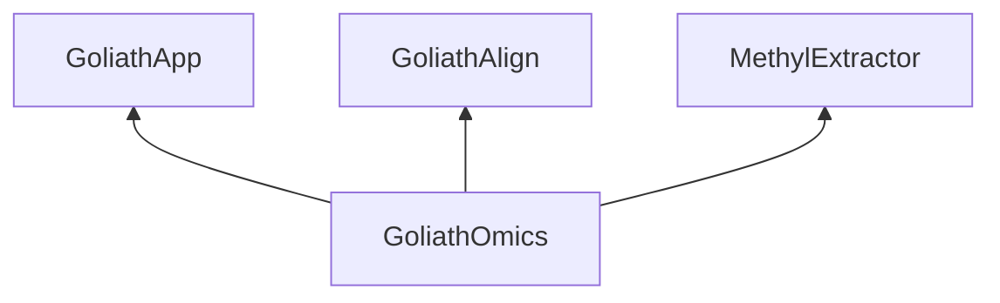

# Dependency direction

GoliathOmics is a specialized application on the GoliathApp platform. It calls GoliathAlign and MethylExtractor as standalone utilities. The dependency edges point toward this repository.

*GoliathOmics depends on the platform and on two utilities. Those three products do not depend on GoliathOmics.*

| Upstream | What this product takes from it | What that product contains about GoliathOmics |
|----------|----------------------------------|-----------------------------------------------|
| [GoliathApp](https://github.com/Goliath-Research/GoliathApp) | Gateway (`methyl-gateway`), engine DDL, RBAC, portal shell, semantic registry, claim and submit protocol, `domain.compiler` used to lower a DomainProgram | No genomics seeds, handlers, or product types |
| [GoliathAlign](https://github.com/Goliath-Research/GoliathAlign) | Pinned image and binaries for linear Mojo alignment and for methylGrapher Align / MethylCall / MergeCpG | No reference to GoliathApp or GoliathOmics |
| [MethylExtractor](https://github.com/Goliath-Research/MethylExtractor) | Pinned binary that writes per-chromosome HDF5 from a linear BAM | No reference to GoliathApp or GoliathOmics |

GoliathAlign and MethylExtractor also carry no reference to each other through this product. GoliathOmics chooses which utility runs for a sample. The WGBS pangenome path calls GoliathAlign for align and for extract. The linear and stock-pangenome paths call MethylExtractor after alignment. Required tool features are listed in [omics-tool-requirements.md](../contracts/omics-tool-requirements.md).

## What stays in this repository

- Science packages under `packages/`
- DomainPrograms, profiles, analytes, and assay procedures under `workflow_engine/domain/`
- Action handlers in `workers/methyl_worker/`
- Database content the platform does not own: `cfg.analyte`, action-catalog and data-type seeds, reference-asset seeds, and the study pipelines
- Release assemble and deploy scripts, deploy profiles, and the worker image bootstrap
- Portal clinical domain DDL, organization-scoped customers, typed omics `ActionSpec` catalog, and `seed_action_catalog.py` after apply

How P1b organization tenancy, O1 action catalogs, and O2 worker sessions fit together: [Semantic layer integration](semantic-layer.md).

The gateway process installed from a GoliathOmics release is the GoliathApp wheel. Its console script is `methyl-gateway`. `goliath-gateway` is the platform name for that service. This repository does not contain `workflow_engine/rest/`.

## Names

`methyl-*` remains the genomics CLI alias for one release cycle (`methyl-workflow-run`, `methyl-cfg`, `methyl-study-start`). Platform commands use the `goliath` prefix and are documented with GoliathApp.

`GOLIATH_ALIGN_ROOT` points at a GoliathAlign checkout. `MOJO_ALIGN_ROOT` and a sibling directory named `mojo-align` remain one-cycle aliases. Older chapters that say MethylPipeline mean this product. Older chapters that say mojo-align mean GoliathAlign.

GoliathWorkflow is not a run path.
