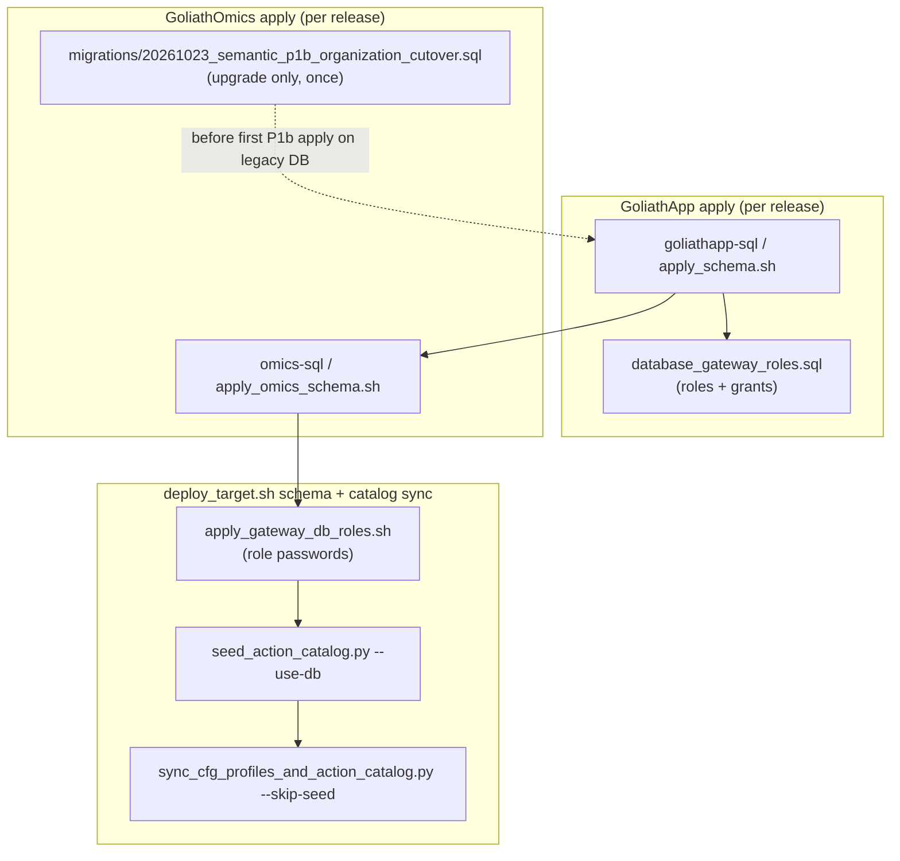

# Semantic layer integration (P1b, O1, O2)

GoliathOmics is a descendant application on [GoliathApp](https://github.com/Goliath-Research/GoliathApp). The platform owns the portal shell, organization tenancy, semantic registry machinery, gateway, and least-privilege database roles. This repository owns genomics domain tables, clinical portal APIs, the typed **ActionSpec** catalog, worker handlers, and the release scripts that apply both layers in order.

Platform background: [GoliathApp semantic layer](https://goliath-research.github.io/GoliathApp/semantic-layer/) and [semantic extensions](https://goliath-research.github.io/GoliathApp/semantic-extensions/). Dependency direction: [dependencies.md](dependencies.md).

## Ownership at a glance

| Concern | Owner | Where it lives |
|---------|--------|----------------|
| Portal shell (`NavTree`, `Organizations`, RBAC scope columns, semantic registry DDL) | GoliathApp | Release `goliathapp-sql/sql_pg/` |
| Organization tenancy (`portal."Organizations"`, `Customers.OrganizationID`) | GoliathApp shell + Omics clinical DDL | GoliathApp P1a; Omics `portal_clinical_schema.sql` |
| Clinical / customer tables (`Customers`, `Diseases`, `Samples`, …) | GoliathOmics | `workflow_engine/sql_pg/portal_clinical_*.sql` |
| Typed action catalog (`ActionSpec`, `wf.workflow_action`, JSON schemas) | GoliathApp machinery + Omics specs | `goliath_app.actions`; Omics entry point `goliath.action_catalogs` |
| Worker dispatch metadata (CLI, capabilities, affinity) | GoliathOmics | `workers/methyl_worker/action_runtime.py` |
| Gateway worker REST (enroll, session, claim, submit) | GoliathApp | `methyl-gateway` wheel |
| DB roles `goliath_gateway`, `goliath_portal` | GoliathApp | `database_gateway_roles.sql` in the GoliathApp bundle |



## Organization tenancy (P1b)

Every `portal."Customers"` row carries a non-null **`OrganizationID`** foreign key to `portal."Organizations"`. Clinical list APIs and cross-schema joins scope data through that column (see `portal_clinical_api.sql`). Contract rows use **`OrganizationID`** instead of legacy `CustomerID` after cutover.

**Greenfield installs** (new database): run GoliathApp `apply_schema.sh`, then Omics `workflow_engine/sql_pg/apply_schema.sh` (or release `apply_omics_schema.sh`). No cutover script is required.

**Upgraded databases** (pre–P1a EpiPortal or early pilots): run the one-time migration **before** the first P1b release apply:

```bash
psql -v ON_ERROR_STOP=1 -f workflow_engine/sql_pg/migrations/20261023_semantic_p1b_organization_cutover.sql
```

That script backfills `OrganizationID` on `Customers`, rewrites `Contract."Contracts"` from `CustomerID` to `OrganizationID`, and migrates RBAC scopes from institution/lab keys to organization scope. It is **not** in `apply_schema.sh` or the release `omics-sql` bundle.

## Portal shell vs clinical domain

GoliathApp P1a owns the **portal shell**: navigation tree, organizations, session entry points, and semantic registry tables (`portal.semantic_*`). GoliathOmics P1b owns **clinical domain** DDL and APIs:

- `portal_clinical_schema.sql` — customer, disease, sample, and related tables (with `Customers.OrganizationID`)
- `portal_sample_extras_schema.sql`, `legacy_cross_schema_fks.sql`
- `portal_clinical_api.sql`, `portal_clinical_api_parity.sql`, `portal_clinical_nav.sql`

Apply order is fixed in `workflow_engine/sql_pg/apply_schema.sh` and reproduced in release bundles by `scripts/bundle_omics_sql.py`.

## Typed ActionSpec catalog (O1)

Workflow actions are **data**: each action has a stable name, capability, JSON input/output schemas, and optional in-process handler path. GoliathApp provides `ActionSpec`, the merged catalog loader (`goliath_app.actions.registry.load_action_catalog`), and engine actions in the `engine` namespace. GoliathOmics registers domain actions through setuptools entry points:

```toml
[project.entry-points."goliath.action_catalogs"]
omics = "methyl_worker.action_catalog:ACTION_CATALOG"
```

`workers/methyl_worker/action_catalog.py` builds the omics `ActionSpec` list; `action_runtime.py` holds **runtime dispatch** rows (CLI tools, affinity, idempotency) used by workers and by `wf.workflow_action` CLI metadata.

After schema apply, **`workflow_engine/sql_pg/seed_action_catalog.py --use-db`** upserts:

1. **Semantic rows** — every merged `ActionSpec` into `wf.workflow_action` / `wf.workflow_action_schema` via `wf_repo_upsert_semantic_action` and `wf_repo_upsert_action_schema`
2. **Runtime metadata** — omics `RUNTIME_CATALOG` dispatch fields via `wf_repo_upsert_workflow_action`

Release deploy runs this automatically inside `scripts/deploy_target.sh` → `run_catalog_sync` **before** `deploy_workflow_definitions.sh`, so compiled DomainPrograms resolve action names that already exist in the database. Manual equivalent:

```bash
export PGHOST=... PGDATABASE=... PGUSER=... PGPASSWORD=...
# Install methyl-gateway wheel or editable goliath_app + workers on PYTHONPATH
python workflow_engine/sql_pg/seed_action_catalog.py --use-db
```

CI checks exported JSON drift with `goliath-export-action-schemas` against `schemas/actions/catalog.json`.

### Core override: `validation.plan_iterations`

Monte Carlo study planning is a **core** action in GoliathApp (`namespace=core`). GoliathOmics supplies a typed **override** (`overrides="core"`, `namespace=omics`) in `workers/methyl_worker/omics_core.py`: subclasses of `PlanIterationsInput` / `PlanIterationsOutput` add omics-only fields (worker tool names, ordered comparison labels, centroid seed groups) while keeping the same `action_name` **`validation.plan_iterations`**. The portal may still pre-plan via `POST /v1/validation/plan-iterations`; workflow nodes use the merged catalog row the seeder wrote.

Platform `workflow.*` compute actions (for example `workflow.compute`) live in **`goliath_app.engine`** only; they are not registered from this repository.

## Worker session auth (O2)

Worker **enrollment** is unchanged: `POST /v1/workers/enroll` with `cluster_key`, `external_worker_key`, and capabilities. The gateway returns numeric **`worker_id`** and enrollment **`worker_token`** (identity), stored in `/etc/methyl/worker-token`.

Before claiming tasks, the poll loop opens a **gateway session**:

| Step | HTTP | Headers / body |
|------|------|----------------|
| Open session | `POST /v1/workers/session` | Body: `worker_id`. **No** `Authorization` on this call. Identity: `X-Goliath-Worker-Token: <enrollment token>`. |
| Claim / submit | `POST /v1/workers/tasks/request`, `POST /v1/workers/tasks/{id}/submit` | `Authorization: Bearer <session token>`, `X-Goliath-Worker-Token`, `worker_id` in JSON body |
| Heartbeat | Same session routes | Bearer + identity header; runner refreshes the session before TTL (`WORKER_HEARTBEAT_SECONDS` × `WORKER_SESSION_MISS_FACTOR`) |

Implementation: `workers/methyl_worker/client.py`, `workers/methyl_worker/runner.py`. Session DDL and `wf` worker session procedures ship in the **GoliathApp** bundle (`rbac_session_tokens.sql`, `wf_worker_session_api.sql`); Omics documents policy only in `workflow_engine/sql_pg/migrations/20261023_semantic_o2_worker_session_auth.sql`.

Operators: [Deployment and distributed workflow](../usage/14-deployment-and-distributed-workflow.md#worker-configuration) and [Release, deploy, and worker enrollment](../operators/release.md#worker-enrollment).

## Database roles: `goliath_portal` and `goliath_gateway`

GoliathApp **`database_gateway_roles.sql`** creates two login roles:

- **`goliath_gateway`** — used by `methyl-gateway` when a gateway role password is configured
- **`goliath_portal`** — used by application backends that call `portal.sp_*` only (no direct table `SELECT`)

Grants are least-privilege: execute on approved procedures, not broad DML on `wf` / `portal` tables.

After GoliathApp and Omics SQL apply, **`scripts/apply_gateway_db_roles.sh`** sets login passwords from the environment. Deploy resolves profile secrets `GOLIATH_GATEWAY_DB_PASSWORD` and `GOLIATH_PORTAL_DB_PASSWORD` (see `deploy/targets/goliath-test.json` and [Deploy targets](../deploy-targets.md#goliath-test)). Schema apply continues to use the admin `database.user`; role passwords are applied in the same `run_schema` transaction batch.

Workers **do not** receive database connection strings; they talk to the gateway over HTTPS only.

## Operator checklist

### New environment

1. Apply GoliathApp SQL from the release bundle (`apply_goliathapp_schema.sh`).
2. Apply Omics domain SQL (`apply_omics_schema.sh`).
3. Set `GOLIATH_GATEWAY_DB_PASSWORD` / `GOLIATH_PORTAL_DB_PASSWORD` and run `apply_gateway_db_roles.sh` (or full `deploy_target.sh --component schema`).
4. Run catalog sync (deploy) or manually: `seed_action_catalog.py --use-db`, then `deploy_workflow_definitions.sh`, then cfg sync if needed.
5. Enroll workers; poll path opens gateway sessions automatically.

### Legacy database first P1b upgrade

1. Run `migrations/20261023_semantic_p1b_organization_cutover.sql` once.
2. Continue with the normal per-release GoliathApp + Omics apply and catalog sync.

## Related

- [Release, deploy, and worker enrollment](../operators/release.md)
- [Deploy targets](../deploy-targets.md)
- [Config registry](../usage/19-config-registry.md) — cfg sync and `sync_cfg_profiles_and_action_catalog.py`
- [Content-addressed action store](../usage/17-content-addressed-action-store.md) — execution-scope hooks from the omics entry point
