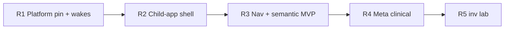

# GoliathOmics refresh plan (R0 audit → R1…R5)

**Status:** gap audit and phased roadmap (R0). No runtime behavior changes until R1+.

**Reference baselines (Nov 2026):**

| Repository | Role |
|------------|------|
| [GoliathApp](https://github.com/Goliath-Research/GoliathApp) `main` | Platform: Meta redesign (PRs #28–#33), dual-activation wake broker (PR #24), shared `inv` module (PR #34), semantic registry, gateway, `wf` engine |
| [GoliathCrop](https://github.com/Goliath-Research/GoliathCrop) | Child-app pattern: `database/schema/`, `scripts/apply_domain_schema.sh`, `src/goliath_crop/`, semantic export + NavTree seeders, `08_crop_wf_wake.sql` |
| [GoliathFactory](https://github.com/Goliath-Research/GoliathFactory) | Same pattern + `fac_mfg_inv` wrapping `inv.*` for traceability |
| **GoliathOmics** `main` | Mature genomics science stack; semantic **O-phases** merged Oct 2025 (PR #65); dual-activation **spike** (PR #68); still on pre-Meta clinical ER and legacy repo layout |

David’s rules for child apps: model domain through the **semantic layer** and **typed ActionSpec** actions (Pydantic everywhere), extend **NavTree**, stay lean. GoliathAlign and GoliathExtractor remain **standalone utilities** (no GoliathApp dependency).

---

## 1. Gap audit

### 1.1 Meta adoption

| Expected (GoliathApp `main`) | GoliathOmics today | Gap |
|------------------------------|-------------------|-----|
| Single-inheritance `"Meta"."Classes"`, `"Meta"."ObjValues"` JSONB, per-class JSON Schema + Postgres validation, recursive class views (`meta_model_phase_a`…`e`, `meta_model_semantic.sql`) | Clinical/customer data lives in **raw ER tables** (`portal."Customers"`, `"Diseases"`, `"Samples"`, `"Labs"`, …) in `workflow_engine/sql_pg/portal_clinical_schema.sql` | **No** `Meta` classes, **no** `portal.semantic_entity` ↔ Meta sync for omics domain |
| Semantic entities derived from Meta classes | `wf.data_type` + JSON schemas seeded from `schemas/domain/` (`seed_data_types.py`) | Workflow **domain types** exist; **not** wired to Meta published types |
| Pydantic models as schema source of truth for portal reads | Portal reads via `portal.sp_list_*` SQL returning table columns | Parallel model: ER tables + ad hoc procs, not semantic registry |

**Risk if unchanged:** two sources of truth (ER DDL vs Meta/semantic); portal modernization (Node/React) cannot reuse Crop/Factory Exograph patterns for clinical screens.

### 1.2 Semantic entities and requests

| Crop/Factory pattern | GoliathOmics today | Gap |
|----------------------|-------------------|-----|
| `database/schema/*_semantic*.sql` — `fn_semantic_*` list/get/write procs, `SECURITY DEFINER`, org/farm/site scope | `portal_clinical_api.sql` — stable SQL API, **mixed** tenancy (some procs filter `CustomerID` / join `OrganizationID`; e.g. `sp_list_diseases()` has **no** user/org guard) | No omics **namespace** in `portal.semantic_*`; no request catalog for clinical CRUD |
| Python `goliath_* .semantic.{models,catalog,export}` + seed CLI | None (only workflow JSON schemas + ActionSpec) | Missing export/seed tooling for portal semantic layer |
| `portal_semantic_row_types.sql` in domain apply | Relies on GoliathApp bundle only | OK for platform types; omics-specific row types not registered |

**Coverage note:** Workflow **science** is well typed (`schemas/domain/registry.json` — 14 domain ref types; `schemas/tasks/*`; guardrail editor types in `seed_data_types.py`). **Clinical portal** is not expressed as semantic entities/requests.

### 1.3 ActionSpec coverage

| Area | Status |
|------|--------|
| Entry point `goliath.action_catalogs` / `omics` | **Done** — `workers/pyproject.toml`, `workers/methyl_worker/action_catalog.py` |
| Typed `ActionSpec` built from Pydantic + `RUNTIME_CATALOG` | **Done** — `action_spec_build.py`, exported `schemas/actions/catalog.json` (**68** actions) |
| Runtime dispatch metadata (capabilities, affinity, idempotency) | **Done** — `action_runtime.py` |
| DB seed | **Done** — `workflow_engine/sql_pg/seed_action_catalog.py` |
| Core override `validation.plan_iterations` | **Done** — `omics_core.py` |
| CI drift check | **Done** — `goliath-export-action-catalog` / catalog JSON |
| `goliath.execution_scope_hooks` / `foreach_bundle` | **Done** — CAAS hooks |

**Gap (minor):** Keep catalog aligned when R1 bumps `goliath_app` — new engine actions or stricter `ActionSpec` validation may require schema_version bumps or export regen only (no architectural gap).

### 1.4 NavTree

| Crop/Factory | Omics |
|--------------|-------|
| `05_nav_*.sql` + `goliath-*-seed-nav` Python seeder (idempotent `portal.sp_nav_register_node`) | Single SQL function `portal.sp_register_omics_clinical_nav()` — one node **“Clinical data”** (`portal_clinical_nav.sql`) |

**Gap:** No NavTree for workflows, study enrollment, process packs, lab batches, or operator tools. No frame keys tied to semantic list functions (Crop pattern).

### 1.5 RLS and API security

| Crop/Factory | Omics |
|--------------|-------|
| Domain `04_rbac_*`, `fn_user_can_access_*` on semantic functions | Organization cutover (P1b) on `Customers`; RBAC scope migration in one-time SQL |
| Consistent `p_user_id` on semantic APIs | Clinical list procs often **omit** caller identity; gateway is expected to gate routes |

**Gap:** No Postgres **ROW LEVEL SECURITY** on omics-owned portal tables; least-privilege relies on not granting table access to `goliath_portal` (procs only). Hardening to Crop-style `SECURITY DEFINER` + explicit org scope on **every** read/write path is unfinished.

### 1.6 DomainPrograms, gateway claim, wakes

| Area | Status |
|------|--------|
| DomainPrograms compiled to `wf` graph | **Done** — 41 fixtures under `workflow_engine/domain/fixtures/` |
| Gateway claim / submit | **Done** — GoliathApp engine; workers via `methyl-worker` |
| Study start queue | **Done** — `workflow_engine/ops/study_start_queue.py`, `cfg.study_start_request` (platform) |
| Dual activation tier 1 | **Documented, not enabled** — [dual-activation-omics-spike.md](dual-activation-omics-spike.md) (PR #68); `WF_WAKE_POSTGRES` / `WORKER_WAKE_POSTGRES` commented in `deploy/env/*.example` only |
| Domain-specific wake queues (Crop `crop_wf`, Factory `fac_mfg_wf_wake`) | **Intentionally omitted** — spike says use platform broker only |

**Gap:** Release pin and deploy profiles do not yet turn on wake flags; CI still checks out GoliathApp **`c7ae4d8`**, not `main` with PR #24 broker.

**Layout gap:** Programs live under `workflow_engine/domain/` (historical) vs child-app `domain_programs/` (Crop/Factory). Cosmetic for merge strategy but affects discoverability.

### 1.7 `inv` (lab consumables / reagents)

| GoliathApp `inv_*` | Omics |
|--------------------|-------|
| Shared inventory/purchasing (`inv_schema.sql`, `inv_api.sql`, `inv_semantic.sql`) | `portal."Labs"`, `"Batches"`, `"LabSamples"` — **no** link to `inv.stock_lot`, PO/receipt, or semantic `inv.*` actions |

**Fit:** Methylation kit lots, index sets, extraction reagents, and QC control materials map naturally to `inv` + optional `omics_lab_inv` bridge (Factory’s `fac_mfg_inv` pattern). **Defer** until Meta/semantic R2–R4 stabilize org-scoped writes.

### 1.8 Stale MethylExtractor naming

| Layer | Status |
|-------|--------|
| Product ids / `goliath_extractor.py` | **Canonical** GoliathExtractor + documented legacy env aliases |
| PR #69 | Renamed integration paths on `main` |
| Remaining user-facing strings | README still linked **MethylExtractor** repo in one line (fixed in R0); QC log strings and older usage chapters still say “MethylExtractor” in prose (many intentional one-cycle aliases) |
| Scripts | `methyl_extractor_local.sh`, `METHYL_EXTRACTOR_HOME` — **keep** as compatibility shims |

**R0 tweak:** top-level README dependency link → GoliathExtractor. **Later phase:** grep-driven doc pass; do not rename boot scripts in one bulk change (operator runbooks).

### 1.9 GoliathApp dependency pins

| Location | Pin |
|----------|-----|
| `workers/pyproject.toml` | `GoliathApp.git@c7ae4d807f37569cded3a6d34ed436cb40d52f48` |
| `scripts/build_gateway_wheel.sh` | `GOLIATH_APP_REF` default `c7ae4d8` |
| `.github/workflows/pr.yml` | GoliathApp checkout `c7ae4d8` for schema integration tests |

**Gap:** ~**40 commits** behind GoliathApp `main` (`1a0fe269…` at audit time), missing Meta phases, `inv` DDL in apply order, `meta_model_semantic`, and dual-activation broker. Staying pinned blocks R2–R5 assumptions.

### 1.10 Docs and `product.json`

| Artifact | Assessment |
|----------|------------|
| `.goliath/product.json` | Accurate for O1/O2/P1b; `status: ready`; does not mention Meta refresh or child-app structural gap |
| [semantic-layer.md](architecture/semantic-layer.md) | Strong for O-phases; silent on Meta redesign and Crop-style semantic entities |
| [dependencies.md](architecture/dependencies.md) | Correct utility direction |
| Repo layout docs | Describe `workflow_engine/sql_pg/apply_schema.sh`, not `scripts/apply_domain_schema.sh` |

---

## 2. Phased roadmap (independently mergeable)

Each phase is a **separate PR series** on `cursor/…-1552` branches. Later phases may **depend** on earlier merges for pins or DDL order, but should not mix unrelated scope.

### R1 — Platform baseline: pin GoliathApp `main`, wakes, CI

**Goal:** Consume current platform DDL (Meta scripts, `inv`, wake broker) without remodelling omics clinical data yet.

**Scope:**

- Bump `GOLIATH_APP_REF` / `methyl-gateway` git pin to a tagged GoliathApp release SHA (or rolling `main` SHA recorded in release manifest).
- Update `.github/workflows/pr.yml` GoliathApp checkout to the same SHA.
- Run full schema integration tests (`test_apply_goliathapp_schema.sh`, deploy script tests).
- Enable **documented** dual activation on `goliath-test` profile only: `WF_WAKE_POSTGRES=1`, `WORKER_WAKE_POSTGRES=1` in profile secrets or env templates; cross-link [dual-activation-omics-spike.md](dual-activation-omics-spike.md).
- Refresh [semantic-layer.md](architecture/semantic-layer.md) “platform bundle contents” paragraph (Meta + inv now in apply order).

**Primary files:**

- `workers/pyproject.toml`
- `scripts/build_gateway_wheel.sh`
- `.github/workflows/pr.yml`
- `deploy/targets/goliath-test.json`, `deploy/env/gateway.postgres.env.example`, `deploy/env/worker.env.example`
- `docs/operators/release.md` (pin bump note)

**Migrations:** None omics-owned; rely on GoliathApp bundle apply once per release.

**Risks:**

- Meta DDL on existing DBs may require GoliathApp migration scripts not yet run in production — coordinate DBA apply order.
- Stricter `ActionSpec` or registry load failures — run `seed_action_catalog.py --use-db` and export catalog in CI after bump.

**Merge gate:** green PR CI + Bugbot; smoke deploy to `goliath-test` optional but recommended.

---

### R2 — Child-app packaging shell (no clinical Meta yet)

**Goal:** Align repo **shape** with Crop/Factory without moving science code.

**Scope:**

- Add `scripts/apply_domain_schema.sh` that applies the same ordered scripts as today’s `workflow_engine/sql_pg/apply_schema.sh` (wrapper or move list to one source of truth).
- Add `database/schema/` as the **canonical** path for new omics DDL; keep `workflow_engine/sql_pg/` as thin re-exports or symlinked copies for one release cycle (document deprecation).
- Introduce minimal `src/goliath_omics/` package:
  - `pyproject.toml` at repo root **or** nested package mirroring Crop (product decision: single root `pyproject.toml` with hatchling).
  - Move **non-worker** entry points when ready: `goliath-omics-seed-nav`, `goliath-omics-semantic-export` (stubs OK that call existing SQL).
- Add `domain_programs/README.md` pointer to `workflow_engine/domain/fixtures/` (or copy SamplePrep + lifecycle fixtures into `domain_programs/` incrementally in R4).

**Primary files:**

- `scripts/apply_domain_schema.sh`, `scripts/apply_omics_schema.sh` (delegate)
- `database/schema/*.sql` (initial copy from `workflow_engine/sql_pg/portal_*`, `cfg_analyte_catalog.sql`)
- `src/goliath_omics/__init__.py`, `pyproject.toml`
- `docs/architecture/dependencies.md`, `docs/usage/14-deployment-and-distributed-workflow.md`

**Migrations:** None if copy-only; if paths change in release bundle, update `scripts/bundle_omics_sql.py`.

**Risks:** Release assemble paths (`omics-sql/`) must stay stable until deploy scripts updated — use dual-path apply in one release.

---

### R3 — NavTree + portal semantic MVP (clinical read paths)

**Goal:** Extend NavTree and register **read-only** semantic entities for clinical operator UX (parity with Crop MVP).

**Scope:**

- Replace/augment `portal_clinical_nav.sql` with Python seeder (`goliath-omics-seed-nav`) registering nodes, e.g. Clinical, Studies, Samples, Labs, Enrollment (frame keys + semantic list codes).
- Add `database/schema/NN_omics_semantic_mvp.sql`:
  - `fn_semantic_*` list functions for diseases, customers (org-scoped), groups, samples — **require `p_user_id`**, use `portal` RBAC helpers from GoliathApp.
  - Register entities/requests via platform semantic catalog procedures (mirror Crop `07_crop_semantic_mvp.sql`).
- Pydantic read models in `src/goliath_omics/semantic/models.py` + export CLI producing JSON for catalog sync.
- Harden existing `portal_clinical_api.sql` procs: deprecate unscoped lists or route through semantic functions.

**Primary files:**

- `database/schema/05_nav_omics.sql`, `07_omics_semantic_mvp.sql`
- `src/goliath_omics/semantic/{models,catalog,export}.py`, `seed/nav_tree.py`
- `workflow_engine/sql_pg/portal_clinical_api.sql` (compat wrappers)
- Tests under `tests/test_omics_semantic.py` (psql or pytest against temp DB)

**Migrations:**

- `migrations/2026xxxx_omics_semantic_mvp.sql` if renaming procs or adding columns for semantic codes (prefer additive).

**Risks:** Portal UI still Delphi — frame keys must match what portal team expects; coordinate frame key names before merge.

---

### R4 — Meta-backed clinical domain (incremental cutover)

**Goal:** David’s rule: **semantic layer + Pydantic** instead of raw ER as the long-term source of truth.

**Scope (incremental — not big-bang):**

- Define Meta classes for core clinical types (Customer org scope, Disease, Patient, Sample, LabBatch) with JSON ObjValues mirroring critical columns.
- SQL: `Meta.sp_semantic_sync_class_entity` registrations (`meta_model_semantic` patterns from GoliathApp).
- Write paths: semantic **requests** for controlled creates/updates (samples, group membership) replacing direct table DML from portal.
- Read paths: views or `fn_semantic_*` reading Meta/obj or synchronized materialized projections from legacy tables during transition.
- Update [semantic-layer.md](architecture/semantic-layer.md) with Meta ownership table.
- One-time migration: backfill Meta objs from existing portal rows; keep legacy tables as storage or drop after verification.

**Primary files:**

- `database/schema/08_omics_meta_clinical.sql`, `migrations/2026xxxx_portal_to_meta_backfill.sql`
- `src/goliath_omics/semantic/models.py` (write models)
- `portal_clinical_schema.sql` (alter — add `meta_object_id` FKs or deprecate columns)
- `.goliath/product.json` feature bullet for Meta clinical model

**Migrations:** **High touch** — requires maintenance window or dual-write period.

**Risks:** Data cutover bugs affect production clinical portal; feature-flag writes per entity; extensive psql tests + rollback script.

---

### R5 — Lab inventory (`inv`) integration

**Goal:** Track lab consumables/reagents through shared `inv` where it reduces custom lab tables.

**Scope:**

- Add `omics_lab_inv` schema (Factory-style bridge): link `portal."Labs"` / `"Batches"` to `inv.stock_lot`, optional PO/receipt helpers wrapping `inv.sp_stock_receive`.
- Semantic actions or requests: receive kit lot, consume quantity for batch, list on-hand reagents by org.
- NavTree node “Lab inventory” under Clinical or Labs.
- **Optional** workflow hook: SamplePrep `actionConfig` references lot id for audit trail (no change to science binaries).

**Primary files:**

- `database/schema/15_omics_lab_inv.sql`, `16_omics_inv_semantic.sql`
- `src/goliath_omics/inv/` bridge procs
- Docs: `docs/operators/lab-inventory.md`

**Migrations:** Additive tables; org-scoped seeds for demo bins/locations in test-bed only.

**Risks:** Overlap with future GoliathApp portal inventory UI — keep bridge thin; do not fork `inv` DDL.

**Dependency:** R4 org-scoped writes recommended before inventory receipts.

---

## 3. Out of scope (explicit deferrals)

- **Tier-2 product wakes** (FASTQ landed, instrument webhooks) — per PR #68 spike.
- **Replacing** `workflow_engine/domain/fixtures` graph semantics — programs stay JSON DomainPrograms on `wf` engine.
- **Moving** science packages under `src/` — stay in `packages/` for wheel/build stability.
- **Renaming** all `methyl_*` CLI/systemd units in one phase — platform alias cycle not complete.
- **Exograph** service deployment — only schemas/procs/exports in omics repo; runtime lives with portal stack.

---

## 4. Suggested merge order

R1 and R2 can overlap in planning but **merge R1 first** (green CI on new GoliathApp SQL). R3 and R4 can split by entity (samples before diseases) if smaller PRs are needed.

---

## 5. R0 deliverable checklist

- [x] Gap audit (this document)
- [x] Phased R1–R5 with scope, files, migrations, risks
- [x] R1 execution (follow-on PRs)
- [ ] R2 child-app shell (follow-on PR)

**Related:** [Semantic layer integration (O-phases)](architecture/semantic-layer.md), [Dual activation spike](dual-activation-omics-spike.md), [Dependency direction](architecture/dependencies.md).
