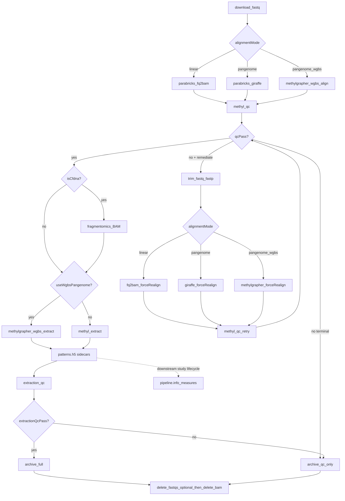

# Sample Prep and Quality Control

## Purpose

**SamplePrepPipeline** is the per-sample upstream workflow that turns raw WGBS FASTQs into methylation HDF5 files (`{chromosome}-CG.h5`) that downstream stages consume. Every sample passes through **two automated guardrails** before it enters stability, freeze, or discovery workflows:

1. **Alignment QC** (`sample.methyl_qc`) — mode-aware guardrails over Parabricks or methylGrapher metrics (shared checks + tool-specific); may trigger focused trim/realign on the **same** align path.
2. **Extraction QC** (`sample.extraction_qc`) — confirms MethylExtractor or methylGrapher extract produced sufficient coverage and conversion-quality signal across chromosomes.

Both gates honor the `resolvedConfig` window baked by `finalize_instance_context`, then a per-sample overlay. See [Baked QC window](#baked-qc-window).

Without these gates, bad alignments would spend worker time, and under-covered or poorly converted extractions would pollute centroids, DMP discovery, and classifiers.

Each sample takes one of four align paths: linear Clara Parabricks, linear GoliathAlign, stock Giraffe, or methylGrapher. The BAM stays on that worker's local scratch until `sample.delete_bam`. Extraction for linear and stock pangenome is MethylExtractor. Extraction for WGBS pangenome is methylGrapher MethylCall / MergeCpG. Both publish `*.h5` and `*.json` into `sampleDir`.

**Start an instance:** [Start a SamplePrep instance](../operators/start-sample-prep.md)

**Workflow source of truth:** [`workflow_engine/domain/fixtures/sample_prep.program.json`](../../workflow_engine/domain/fixtures/sample_prep.program.json)

**Storage contract:** [`workflow_engine/contract/SamplePrepFlow.md`](../../workflow_engine/contract/SamplePrepFlow.md)

**Tooling:** [sample-prep-tooling.md](../architecture/sample-prep-tooling.md)

## Alignment paths

After FASTQ download, SamplePrep chooses **one alignment path** per sample (and the same path on fastp remediation realign). Scope flags come from the procedure and from `finalize_instance_context`. The full matrix, scratch paths, and pin rules are in [Start a SamplePrep instance](../operators/start-sample-prep.md).

| Path | Scope flags | Worker action | Tool |
|------|-------------|---------------|------|
| **Linear Clara** | `usePangenome: false`, `useWgbsPangenome: false`, `parabricks.engine` `parabricks` (runner default) | `sample.parabricks_fq2bam` | `pbrun fq2bam_meth` |
| **Linear GoliathAlign** | Same flags, `parabricks.engine` `mojo` | `sample.parabricks_fq2bam` | MojoFq2bamMeth. `align_device` may be `cpu`. Procedure `buffy_wgbs_linear_mojo_gene_fc`. |
| **Stock Giraffe** | `usePangenome: true`, `useWgbsPangenome: false` | `sample.parabricks_giraffe` | `pbrun giraffe` |
| **methylGrapher** | `useWgbsPangenome: true` | `sample.methylgrapher_wgbs_align` | methylGrapher Align. `align_engine` defaults to `cpu_vg` when unset; procedures set `gpu_giraffe` or `mojo_giraffe`. |

**How a procedure selects a path:**

- Stock Giraffe: `alignmentMode: "pangenome"` (binds `usePangenome`).
- WGBS methylGrapher: `alignmentMode: "pangenome_wgbs"` (binds `useWgbsPangenome` and `usePangenome`). Procedure `buffy_wgbs_pangenome_gene_fc` selects this mode.
- Buffy linear Clara: `buffy_wgbs_linear_gene_fc`.
- Buffy linear GoliathAlign: `buffy_wgbs_linear_mojo_gene_fc`.

`seed_pipeline_scope_flags` (gateway `pipeline_profiles` module, called from `enrich_instance_context`) derives `usePangenome` and `useWgbsPangenome` from the merged profile and procedure. Set those flags, or `alignmentMode`, on the start request when the procedure should not be the only source.

**WGBS note:** stock HPRC graphs are not bisulfite-aware. Provision the bisulfite bundle the procedure names (`pangenome-grch38-d9-bs-1.70` in the canary notes) and set `actionConfig.methylgrapher_wgbs`. The canary checklist is `workers/tests/test_methylgrapher_wgbs_canary.md`. Unset `align_engine` runs `cpu_vg` (`methylgrapher_wgbs_runner._normalize_align_engine`).

**Extraction branch:** when `useWgbsPangenome` is true, SamplePrep runs `sample.methylgrapher_wgbs_extract` instead of `sample.methyl_extract`. Alignment QC is mode-aware: methylGrapher provenance/GAF/BAM baseline, with optional Picard enrichment when Align set `collectmultiplemetrics: true`.

The epi-GBS program uses `sample.docker_align` on `sample_prep_epigbs.program.json`. That action is outside the four-row table and uses the same local-scratch and pin rules.

## End-to-end flow



*Sample prep and QC flow. The linear node is Clara or GoliathAlign according to `parabricks.engine`. Shared QC gates, then the extract branch.*


| Gate | Scope variable | When | Blocks |
|------|----------------|------|--------|
| Alignment | `qcPass` | After linear / Giraffe / methylGrapher QC BAM, **before** extract | Extraction (unless remediation succeeds) |
| Extraction | `extractionQcPass` | After MethylExtractor or methylGrapher extract | Full archive and BAM deletion |

**Ordering rationale:** alignment QC runs before cfDNA fragmentomics so failed samples skip BAM scanning. Fragmentomics and extraction both read the aligned BAM on the pinned worker. FASTQs on `/work` are retained until QC is fully resolved so **fastp** can trim and the **same** alignment path can realign. SamplePrep emits `{chr}-CG.patterns.h5` when read-level extraction is enabled. `pipeline.info_measures` runs later in the study lifecycle.

## Where artifacts live

Production binds **`sampleRoot`** = `/work/samples/{sample_id}/` (FASTQs, `.caas/`) and **`sampleDir`** = `{sampleRoot}/align.{mode}.{engine}/` (metrics, published H5, manifests). The BAM is not on `/work`. Full tooling note: [sample-prep-tooling.md](../architecture/sample-prep-tooling.md).

```text
/work/samples/<id>/                 # sampleRoot: FASTQs, .caas/
  align.linear.parabricks/          # sampleDir (Clara linear)
  align.linear.mojo/                # sampleDir (GoliathAlign linear)
  align.pangenome.parabricks/
  align.pangenome_wgbs.mojo/        # gpu_giraffe / mojo_giraffe / engine=mojo
  align.pangenome_wgbs.vg/          # cpu_vg, and the runner default when unset

{METHYL_LOCAL_TMP}/bam/<slug>-<digest>/{sample_id}.bam
{METHYL_LOCAL_TMP}/extract/<slug>-<digest>/   # published *.h5 and *.json land in sampleDir
```

| Artifact | Location | Role |
|----------|----------|------|
| `*_1.fastq.gz`, `*_2.fastq.gz` | `sampleRoot` on `/work` until archive; a staged copy under local `fastq/` during align | Paired FASTQs |
| `.caas/` | `sampleRoot` | Sample-identity skip store (not per-arm). Align BAMs are a `worker_local_bam` opt-out. |
| `{sample_id}.bam` | `{METHYL_LOCAL_TMP}/bam/{slug}-{digest}/` on the pinned worker | Aligned BAM. Removed by `sample.delete_bam` and by failing pinned tasks. |
| `*deduplicate_metrics.txt` | `sampleDir` | Picard-style duplication metrics from Parabricks / methylGrapher QC BAM |
| `{sample_id}.json` | `sampleDir` | Parabricks WGBS metrics JSON (sequencing + alignment) |
| `{sample_id}.qc-metrics.tar` | `sampleDir` | Optional tar of tabular metrics (used when JSON is absent) |
| `{sample_id}.alignment.gaf` | `sampleDir` | methylGrapher merged GAF (WGBS pangenome mode) |
| `{sample_id}.alignment_metrics.json` | `sampleDir` | methylGrapher align provenance + asset fingerprints |
| `{output_base}/{project}/alignment_qc/{sample_id}.json` | project tree | Normalized **V2.1** `guardrail_summary` export (when run project-scoped) |
| `{sample_id}.extraction_manifest.json` | `sampleDir` | Extractor / methylGrapher extract summary (`read_filtering` when native) |
| `{sample_id}.timing.json` | `sampleDir` | MethylExtractor phase elapsed-ms (BAM scan vs HDF5 write) |
| `{sample_id}.extraction_qc.json` | `sampleDir` | Extraction guardrail report |
| `{sample_id}.sample_prep_log.jsonl` | `sampleDir` | Append-only audit of every prep action |
| `{chr}-CG.h5` | `sampleDir` | Methylation matrices consumed by `methyl-centroid` |
| `{chr}-CG.patterns.h5` | `sampleDir` | Optional read-level pattern sidecars for informME |

## Alignment QC: inputs and normalized JSON

`methyl-qc` (`packages/methylalignmentqc`) is **mode-aware**. It prefers task `alignmentMode` (`linear` | `pangenome` | `pangenome_wgbs`) from [`sample_methyl_qc.input.schema.json`](../../schemas/tasks/sample_methyl_qc.input.schema.json), otherwise infers the metrics family from artifacts. Soft-fail still flows through `guardrails.overall_pass` → workflow `qcPass`. Pass `alignmentMode` (worker) / `--alignment-mode` when artifacts from more than one family could be present.

| Mode | Required artifacts (hard-fail if missing) | Votes on `overall_pass` |
|------|-------------------------------------------|-------------------------|
| `linear` / `pangenome` | Full Parabricks JSON or Picard tar with `quality_yield.txt`; post-dedup metrics | Core Parabricks + alignment-derived + optional + cycle screening |
| `pangenome_wgbs` | Non-empty BAM; dedup; `{id}.alignment_metrics.json` (`tool=methylGrapher`); GAF present | WGBS provenance / GAF / BAM(+flagstat) / dup; **skips** Parabricks core, cycle screening, fragmentomics, pre-adapter |

For `pangenome_wgbs`, QC **must not** fall back to a stale linear Picard `qc-metrics.tar` or stub `{id}.json` left from an earlier linear run.

### Picard-style duplication metrics

Parabricks (and methylGrapher QC BAM markdup) emit a tab-separated **deduplication metrics** file (names vary: `*deduplicate_metrics.txt` or `*duplication_metrics.txt`). The parser (`methyl_alignment_qc/core/parser.py`) reads Picard-compatible columns such as:

- `LIBRARY`, `UNPAIRED_READS_EXAMINED`, `READ_PAIRS_EXAMINED`
- `SECONDARY_OR_SUPPLEMENTARY_RDS`, `UNMAPPED_READS`
- `UNPAIRED_READ_DUPLICATES`, `READ_PAIR_DUPLICATES`
- **`PERCENT_DUPLICATION`**

These feed `summary_stats` on the export JSON (total reads, duplication rate, etc.). Optional config guardrails (`actionConfig.alignment_qc.optional_guardrails.duplication_rate_max`) can fail samples with excessive PCR duplication even when cycle quality looks fine.

### Parabricks metrics JSON (linear / stock pangenome)

Each linear or stock-pangenome sample directory should contain **`{sample_id}.json`**: Parabricks' structured report with sections such as:

- `quality_yield` — total/PF reads and Q30 bases
- `mean_quality_by_cycle` — per-cycle mean Phred (Read 1 then Read 2; for 151+151 cycles, Read 2 starts at cycle 152)
- `gc_bias_summary`, `insert_size_metrics`
- `pre_adapter_summaries` — deamination and OxoG artifact qscores

When this file is present, guardrails in `wgbs_parabricks_qc.py` evaluate sequencing and alignment health **before** methylation extraction. Cycle and insert histograms are used at QC time and are **not** copied into the published alignment QC JSON.

### methylGrapher WGBS provenance (`pangenome_wgbs`)

WGBS pangenome align writes **`{sample_id}.alignment_metrics.json`** (tool=`methylGrapher`) plus GAF / QC BAM / dedup. After the QC BAM is ready, Align may run Parabricks **`collectmultiplemetrics`** (soft-fail if GPU/image unavailable) and pack real Picard tables into `{sample_id}.qc-metrics.tar`. Provenance then sets `collectmultiplemetrics: true`. Mode-aware QC keeps WGBS provenance as the hard baseline and **optionally** merges Parabricks core + cycle screening when that flag is set and tables are complete — never from a stale linear tar without the flag. BS chemistry can skew artifact/GC metrics; treat Picard enrichment as operational screening only. Guardrails: `wgbs_pangenome_qc.py` (+ optional `wgbs_parabricks_qc`).

### Our equivalent export JSON (V2.1)

The worker writes a slim **guardrail summary** per sample (schema: `schemas/config/alignment_qc/exported_sample_qc_v2.schema.json`, `export_kind: guardrail_summary`). This file is a disk export (`qcPath`); it is **not** `MethylQcTaskInput`. Picard cycle/GC/insert/duplication histograms stay in `{sample_id}.json` or `{sample_id}.qc-metrics.tar`. **Canonical analysis path:** `guardrails.details` only. Nested `bisulfite_conversion` is sidecar conversion rates, not a second copy of deamination.

| Block | Contents |
|-------|----------|
| `summary_stats` | Duplication rate, read counts from Picard metrics |
| `quality_yield`, `gc_bias_summary`, `insert_size_metrics` | Small Parabricks scalars (no histograms) |
| `guardrails.details` | Per-metric pass/fail, observed value, normal range, operator message. Deamination: `deamination_qscore` here only. |
| `guardrails.screening` | Cycle-quality disposition and recommended trim counts |
| `guardrails.overall_pass` | **Single boolean** bound to workflow `qcPass` |
| `qc_history` | Append-only list of evaluations (initial + post-remediation retries) |
| `fragmentomics_metrics` | cfDNA insert-size guardrails when enabled |
| `bisulfite_conversion_metrics` | Sidecar conversion provenance (`measurement_source`, rates, notes) |

V1-shaped payloads are assembled internally (with Picard tables for compute) and converted to V2.1 for export; standalone tools can migrate older files with `methyl-qc-convert-v1-to-v2` or `methyl-qc-migrate-guardrails`.

## Baked QC window

`finalize_instance_context` writes `resolvedConfig__alignment_qc` and `resolvedConfig__extraction_qc` from the merged site, profile, procedure, and request `actionConfig`. The compiler copies each slice onto the matching task as `resolvedConfig`.

When that object is present, `resolve_alignment_qc_config` and `resolve_extraction_qc_config` load it with `load_resolved_config` and do not re-read the site from the worker environment. A foreach sample may still overlay the window:

| Gate | Overlay on `sampleContext` |
|------|----------------------------|
| Alignment QC | `core_guardrails`, or `actionConfig.alignment_qc` |
| Extraction QC | `guardrails`, or `actionConfig.extraction_qc` |

The SamplePrep program sets `with.sampleContext` to `${var.sample}` on both QC actions. The overlay is merged on top of the baked window (`sample_alignment_overlay`, `sample_extraction_overlay`).

## Alignment guardrails: what “good alignment” means

Core WGBS guardrails are **operator-configurable**. The **published acceptance window** lives on the **site** (`actionConfig.alignment_qc.core_guardrails` + `extraction_qc.guardrails`). Pipeline profile, assay procedure, and study documents persist only a **sparse overlay** (omit = inherit, JSON `null` = clear). Analyte packs still fill missing keys at instance bake; they are not part of the SQL inherited merge.

When a key is unset after merge, QC still applies this fail-closed window (also the site fixture default):

| Metric | Acceptance window | Config key | Why it matters |
|--------|-------------------|------------|----------------|
| PF read percent | ≥ 90% | `min_pf_percent` | Run-level filtering quality |
| Q30 percent | ≥ 85% | `min_q30_percent` | Base-call confidence |
| Mean quality | ≥ 35 | `min_mean_quality` | Overall sequencing noise |
| Min quality after cycle 20 | ≥ 30 | `min_quality_post20` | Late-cycle degradation |
| AT / GC dropout | < 3 / < 5 | `max_at_dropout` / `max_gc_dropout` | Coverage bias across genome |
| Median insert size | 150–300 bp | `median_insert_min_bp` / `median_insert_max_bp` | Library fragmentation sanity |
| Deamination qscore | ≤ 30 | `max_deamination_qscore` | Expected WGBS conversion signal |
| OxoG qscore | ≥ 20 | `min_oxog_qscore` | Oxidative damage risk |

Widen or tighten a window per **deployment** on the site document rather than editing Python — for example, a cohort whose GC dropout sits just above 5 can be admitted with `"core_guardrails": {"max_gc_dropout": 6.0}` on the site (full window still required) or as a sparse pin on profile / procedure / study. The reported `normal_range` in the QC JSON always echoes the configured value, so a report is self-describing.

Each metric carries a **`message`** explaining the biological/operational concern. `guardrails.overall_pass` is the logical AND of all evaluated checks (including optional and analyte-specific add-ons).

### Optional and analyte-specific checks

Configure under **site** `actionConfig.alignment_qc` for the published window. Profile / procedure / study may pin diffs only (not in the study manifest cohorts file):

```json
{
  "alignment_qc": {
    "core_guardrails": {
      "max_gc_dropout": 6.0
    },
    "optional_guardrails": {
      "duplication_rate_max": 0.25,
      "min_pf_reads": 1000000
    },
    "bisulfite_conversion": {
      "enabled": true,
      "source": "auto",
      "min_conversion_rate_pct": 99.0
    },
    "fragmentomics": {
      "enabled": true,
      "profile": "cfdna"
    },
    "cycle_screening": {
      "enabled": true,
      "r2_quality_threshold": 30,
      "max_trim_bases": 8
    },
    "alignment_guardrails": {
      "enabled": true,
      "min_mapping_rate": 0.98,
      "flagstat_enabled": true,
      "min_properly_paired_rate": 0.90
    }
  }
}
```

- **Core guardrails:** the sequencing/library window in the table above. Only set the keys you need to move; unset keys keep the acceptance window.
- **Alignment guardrails:** mapping rate, secondary/supplementary rate, GC uniformity (Picard-derived), and properly paired rate (`samtools flagstat` on the worker-local BAM). Enabled by default for `cfdna` and `buffy_coat` via analyte profile. See [Analyte profiles](../ANALYTE_PROFILES.md).
- **Bisulfite conversion:** reads `bisulfite_conversion.json` sidecar when present. A missing sidecar with `source: auto` records deamination as a qualitative proxy in `bisulfite_conversion_metrics.notes`; voting still uses `guardrails.details.deamination_qscore` only.
- **cfDNA fragmentomics:** when `primary_analyte` is `cfdna`, insert-size histogram guardrails can flag abnormal fragment profiles before extraction.

See [ANALYTE_PROFILES.md](../ANALYTE_PROFILES.md) for profile defaults.

## Cycle screening and automated recovery

Historically, a single **`min(mq[20:])`** over the combined cycle series could fail fixable Read-2 start dips with a generic “do not proceed” message. **Cycle screening** (`cycle_quality_screening.py`) inspects Read 1 and Read 2 separately and assigns a **disposition**:

| Disposition | Meaning | SamplePrep action |
|-------------|---------|-------------------|
| `USE_CURRENT_ALIGNMENT` | Guardrails pass | Continue to extract |
| `REALIGN_TRIM` / `REALIGN_READ2_TRIM` | Fixable read-end quality dip | `sample.trim_fastq` → Parabricks `forceRealign` → `methyl-qc` retry |
| `INVESTIGATE_MULTI_REGION` | Multiple low-quality regions | Manual review; no auto-trim |
| `INVESTIGATE_GUARDRAIL_ONLY` | Cycles OK; duplication/depth/insert fail | Manual review |
| `NOT_FIXABLE` | No automated path | Archive QC-only artifacts, mark failed |

Screening writes `guardrails.screening` with recommended trim bases (`trim_front1`, `trim_tail1`, `trim_front2`, `trim_tail2`). SamplePrep binds `remediateAlignment` when disposition is trim-eligible and FASTQs are still on disk.

**Important:** FASTQs must **not** be deleted before final alignment QC disposition. The workflow deletes FASTQs only after pass or final reject (including post-remediation retry), and only when instance/profile **`deleteFastqs`** is true (default). Set `deleteFastqs: false` or `actionConfig.sample_prep.delete_fastqs: false` to retain them under `/work/samples/{sample_id}/`.

Offline cohort review (no re-align):

```bash
source .venv/bin/activate
python scripts/alignment_qc_cohort_screening.py \
  --qc-dir /work/projects/prostate-cancer/alignment_qc \
  --group healthy=/work/projects/prostate-cancer/data/healthy.csv \
  --group pca=/work/projects/prostate-cancer/data/pca.csv \
  --out /work/projects/prostate-cancer/alignment_qc/screening_report
```

Default reads stored `guardrails.screening` (slim exports have no cycle tables). Pass `--recompute` and `--picard-dir` pointing at native Parabricks `{id}.json` files to re-run cycle screening.

## Extraction QC: confirming enough good reads

Alignment QC validates the **QC BAM** (linear, stock Giraffe, or methylGrapher-restored BAM). Extraction QC validates the **methylation call layer** produced by MethylExtractor (`sample.methyl_extract`) or methylGrapher (`sample.methylgrapher_wgbs_extract`).

### Input: extraction manifest

Extract manifests are **preserve-or-synthesize**. A complete native `methylextractor.extraction_manifest` (expected chromosomes present, `summary.cpg_weighted_mean_coverage` set) is **kept**, including `read_filtering`. Stubs or incomplete files are synthesized from `{chrom}-{ctx}.json` sidecars; the worker may overlay `h5_files`, `pattern_files`, and action provenance when those lists are missing. methylGrapher extract still writes the canonical blocks plus graph provenance.

Both extractors expose `{sample_id}.extraction_manifest.json` with the **canonical** blocks consumed by `methyl_extraction_qc`:

- `metadata.contexts_extracted` — contexts present in the call set
- `summary` — genome-wide CpG weighted mean coverage, optional CHH/CHG methylation levels
- `per_chromosome` — per-chromosome blocks with `CG.mean_coverage` and related stats

methylGrapher also retains provenance (`tool`, `graph_assets`, `coordinate_system`, H5/pattern paths). Read-filtering stats may be absent on the graph path; the discard-fraction guardrail then reports a skipped check rather than inventing values.

### Output: extraction QC JSON

`methyl-extraction-qc` reads the manifest and writes `{sample_id}.extraction_qc.json`. Default guardrails (`methylextractionqc/guardrails.py`):

| Guardrail | Default | Interpretation |
|-----------|---------|----------------|
| `cpg_weighted_mean_coverage` | ≥ 10× | Enough reads at CpG sites passing minimum coverage |
| `chh_methylation_level` | ≤ 0.02 | Low non-CpG methylation (conversion sanity) when CHH extracted |
| `chg_methylation_level` | ≤ 0.02 | Same for CHG |
| `chromosome_completeness` | all expected chromosomes | Every project chromosome present with CG metrics |
| `chromosome_uniformity` | autosomal min/median ≥ 0.5 | No severe localized dropout |
| `read_discard_fraction` | ≤ 0.9 | Catastrophic read loss (`1 − read_retention_rate`) from extraction-time filters |

`guardrails.overall_pass` maps to workflow **`extractionQcPass`**. Failures are **terminal** today (no automatic retry loop).

Override thresholds via profile `actionConfig.extraction_qc`. Schema: `schemas/extraction_qc_output.schema.json`.

### Why both gates matter

| Question | Answered by |
|----------|-------------|
| Did sequencing and alignment produce a usable BAM? | Alignment QC |
| Did we extract enough confident methylation signal genome-wide? | Extraction QC |

A sample can pass alignment but fail extraction (e.g., coverage collapse on certain chromosomes). Conversely, remediation after alignment QC prevents spending extract **CPU** time on BAMs that will never support stable downstream statistics. Alignment is the GPU-bound step; MethylExtractor is not.

## Pass, fail, and handoff

| Outcome | Alignment QC | Extraction QC | Next step |
|---------|--------------|---------------|-----------|
| Pass both | `qcPass: true` | `extractionQcPass: true` | Optional full archive → `delete_fastqs` if `deleteFastqs` (default true) → delete BAM → sample ready for DataDrivenPipeline |
| Fail alignment (not fixable) | `qcPass: false` | — | QC-only archive, mark failed, skip extract |
| Fail after remediation | `qcPass: false` (attempt 2) | — | Same as above |
| Pass alignment, fail extraction | `qcPass: true` | `extractionQcPass: false` | QC-only archive, mark failed; H5 may exist but must not enter production cohorts |

**FOREACH:** one sample `FAILED` does **not** fail the instance; siblings continue (`READY`/`RUNNING`). The instance can **COMPLETED** after every iteration is terminal. See [`workflow_engine/contract/SamplePrepFlow.md`](../../workflow_engine/contract/SamplePrepFlow.md).

When SamplePrep instance **COMPLETED**, start stability or discovery workflows with the same `projectPath`. Downstream code resolves HDF5 via `methyl_domain.helpers.resolve_methylation_h5_path()` — do not hard-code sample paths.

Workers tag scope with **`MethylSampleRef`** including `alignmentQc`, `extractionQc`, and `methylation` refs for traceability.

## Configuration checklist

Before starting SamplePrep, confirm:

- [ ] `project.json` lists samples and `samples_base_path` / `path_remap` resolve to `/work/samples/...`
- [ ] Site `actionConfig.alignment_qc.core_guardrails` publishes the full QC window; profile/procedure/study only pin diffs. Analyte (cfDNA vs buffy coat) fill-missing still applies at bake.
- [ ] Profile `actionConfig.extraction_qc` min coverage appropriate for WGBS depth expectations
- [ ] `validation.regulatory.primary_analyte` set (drives fragmentomics profile)
- [ ] Instance `context_json` includes `fastqStorage`, `referenceFasta`, `samples[]`
- [ ] Stock pangenome: site `pangenome_genome` bundle staged, `alignmentMode: "pangenome"`
- [ ] Linear / stock extract: `actionConfig.methyl_extract.chrom_parallel` and `max_rss_gb` set for the node's RAM (CPU MethylExtractor)
- [ ] WGBS pangenome: site `pangenome_wgbs_genome` / `actionConfig.methylgrapher_wgbs` staged (`d9-bs/1.70`), `alignmentMode: "pangenome_wgbs"`, `METHYL_MOJO_ALIGN_IMAGE` set; gate promotion with [`workers/tests/test_methylgrapher_wgbs_canary.md`](../../workers/tests/test_methylgrapher_wgbs_canary.md)

## Commands (standalone debugging)

```bash
source .venv/bin/activate

# Standalone alignment QC reads metrics under the arm leaf.
# The worker path reads the BAM from METHYL_LOCAL_TMP on the pinned worker.
methyl-qc --samples /work/samples/SAMPLE_ID/align.linear.parabricks \
  --output-dir /work/projects/prostate-cancer/alignment_qc

# Project-scoped (uses profile actionConfig.alignment_qc via METHYL_PROFILE)
methyl-qc --project /work/projects/prostate-cancer/configs/project_Example.json

# Extraction QC after MethylExtractor (--sample-dir = same arm leaf)
methyl-extraction-qc --sample-dir /work/samples/SAMPLE_ID/align.linear.parabricks \
  --sample-id SAMPLE_ID
```

On the worker path, `sample.methyl_qc` takes `alignmentMode` (`--alignment-mode` when the CLI wrapper forwards it) so family detection stays fail-closed when more than one metrics family could be present.

## Related documentation

- **Start an instance:** [Start a SamplePrep instance](../operators/start-sample-prep.md)
- **Alignment engines matrix:** [`alignment-engines.md`](alignment-engines.md)
- Storage contract: [`workflow_engine/contract/SamplePrepFlow.md`](../../workflow_engine/contract/SamplePrepFlow.md)
- Alignment QC package: [`packages/methylalignmentqc/docs/USAGE.md`](../../packages/methylalignmentqc/docs/USAGE.md)
- Extraction QC package: [`packages/methylextractionqc/README.md`](../../packages/methylextractionqc/README.md)
