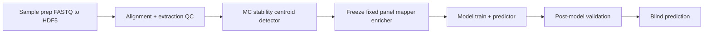

# GoliathOmics Usage Manual

Older chapters in this manual say MethylPipeline. That name means this genomics product. The platform gateway and engine live in GoliathApp. This product specializes that platform and calls GoliathAlign and GoliathExtractor as utilities. See [docs/README.md](../README.md) and [Dependency direction](../architecture/dependencies.md).

Current operator procedures:

- [Start a SamplePrep instance](../operators/start-sample-prep.md) (`methyl-study-start sample-prep-start`, which calls `finalize_instance_context`)
- [Release, deploy, and worker enrollment](../operators/release.md) (release 2026.10.27)
- [Process packs](../operators/process-packs.md)

`methyl-workflow-run` is the local runner installed with the methyl-gateway wheel. This repository does not declare that console script. `methyl-study-start` is the admin CLI in `workflow_engine/admin/study_start.py`.

## What this manual is

This is the operational companion to the theory book. It is designed for execution teams who need:

- exact commands,
- required config keys,
- expected output artifacts,
- stage handoff checks,
- recovery actions when a run fails.

For statistical background, use [`docs/theory/`](../theory/index.md). Compiler and worker behavior for SamplePrep is in [Start a SamplePrep instance](../operators/start-sample-prep.md) and [`workflow_engine/contract/SamplePrepFlow.md`](../../workflow_engine/contract/SamplePrepFlow.md). Start with [Relationship to Theory and Implementation](00-relationship-to-theory-and-implementation.md).

## How to run staged validation

**Start SamplePrep** with `methyl-study-start sample-prep-start`. **Run staged validation** with `methyl-workflow-run` when the methyl-gateway wheel is installed, using a DomainProgram and pipeline profile. Production instances are rows in the workflow database, not a local process.

**`methyl-validation --stability/--freeze/--model` is legacy** — documented for transitional scripts and narrow recovery, not for new workflow design. See [Orchestration: workflow-run](04-orchestration-workflow-run.md) before the stage chapters.

| Goal | Start here |
|------|------------|
| Understand entry points | [Orchestration (ch.04)](04-orchestration-workflow-run.md) |
| First end-to-end run | [Tutorial (ch.16)](16-tutorial-healthy-vs-cancer-stages.md) |
| SaMD holdouts / pivotal path | [SaMD lifecycle (ch.18)](18-samd-study-lifecycle.md) |
| One stage's artifacts and gates | Part II (ch.05–09) — each chapter links back to workflow-run |
| Legacy CLI flags | `packages/methylvalidation/docs/USAGE.md` |

## Reading paths

- **Sample prep (FASTQ → HDF5):** [Start a SamplePrep instance](../operators/start-sample-prep.md), then chapter `03` (`03-sample-prep-and-qc.md`).
- **New project setup:** Chapters `01`, `02`, `04` (orchestration), then `05` or [Tutorial ch.16](16-tutorial-healthy-vs-cancer-stages.md).
- **Fast path (stage execution):** [Orchestration ch.04](04-orchestration-workflow-run.md) → `methyl-workflow-run`; stage detail in ch.05–09.
- **Guided tutorial (healthy vs. cancer stages):** Chapter `16` — end-to-end walkthrough; [profile catalog in ch.16](16-tutorial-healthy-vs-cancer-stages.md#step-4-pick-a-profile).
- **SaMD study ladder (research → holdouts → pivotal):** Chapter `18` — [`18-samd-study-lifecycle.md`](18-samd-study-lifecycle.md); scaffold with `methyl-study-init`.
- **Application packs (config on a process):** Chapter `24` — pattern + checklist; instances in ch.21 (Alzheimer), ch.23 (plant abiotic stress), and [ch.25 (prostate cancer options)](25-prostate-cancer-pack.md).
- **Prostate cancer (research + diagnostic options):** Chapter `25` — [`25-prostate-cancer-pack.md`](25-prostate-cancer-pack.md); physician/payer narrative in the [application deep-dive](../research/Prostate_Cancer_Application_Deep_Dive.md).
- **Hyperparameter versioning (CAAS):** `17-content-addressed-action-store.md` (Part V; follows the tutorial).
- **Daily operations:** `10-artifacts-and-qa-checks.md` through `12-command-cookbook.md`.
- **Scaling MC across machines:** Chapter `13` — shared `/work` storage and queue subcommands.
- **Deployment (DB + gateway + workers):** Chapter `14`.
- **Optional hyperparameter tuning:** Chapter `15` — `methyl-hyperparam-search` grid driver.
- **Standalone package usage:** Chapter `04b` (`04b-package-reference-individual-usage.md`).

## End-to-end workflow map

*End-to-end pipeline stages*

## Scope boundaries

- **SamplePrepPipeline** (FASTQ → aligned BAM → methylation HDF5) runs before staged validation; see Chapter 3.
- **SamplePrep instances:** `methyl-study-start sample-prep-start` — [operator guide](../operators/start-sample-prep.md).
- **Staged validation on a workstation:** `methyl-workflow-run` + DomainProgram + profile, from the methyl-gateway wheel — [chapter 04](04-orchestration-workflow-run.md).
- **Legacy orchestration:** `methyl-validation --stability/--freeze/--model` — transitional scripts and recovery only; do not use for new studies.
- Blind-only prediction is documented as a standalone `methyl-predictor` operation.
- Package behavior is documented from implementation in `packages/*`.

## Canonical references

- Sample prep workflow: [`workflow_engine/contract/SamplePrepFlow.md`](../../workflow_engine/contract/SamplePrepFlow.md)
- DomainProgram fixtures: `workflow_engine/domain/fixtures/*.program.json`
- Dependency direction: [`docs/architecture/dependencies.md`](../architecture/dependencies.md)
- Validation orchestration: `packages/methylvalidation/docs/USAGE.md`
- Distributed queue: `packages/methylvalidation/docs/DISTRIBUTED_QUEUE.md`
- Hyperparameter search: `packages/methylvalidation/docs/HYPERPARAMETER_SEARCH.md`
