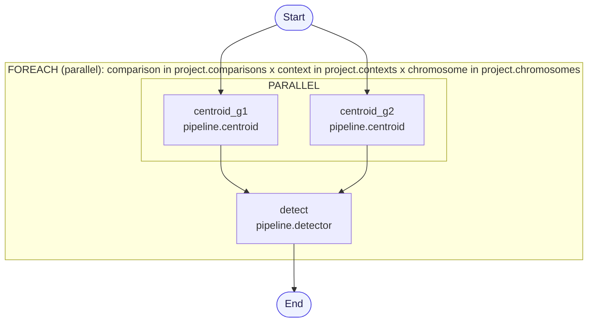
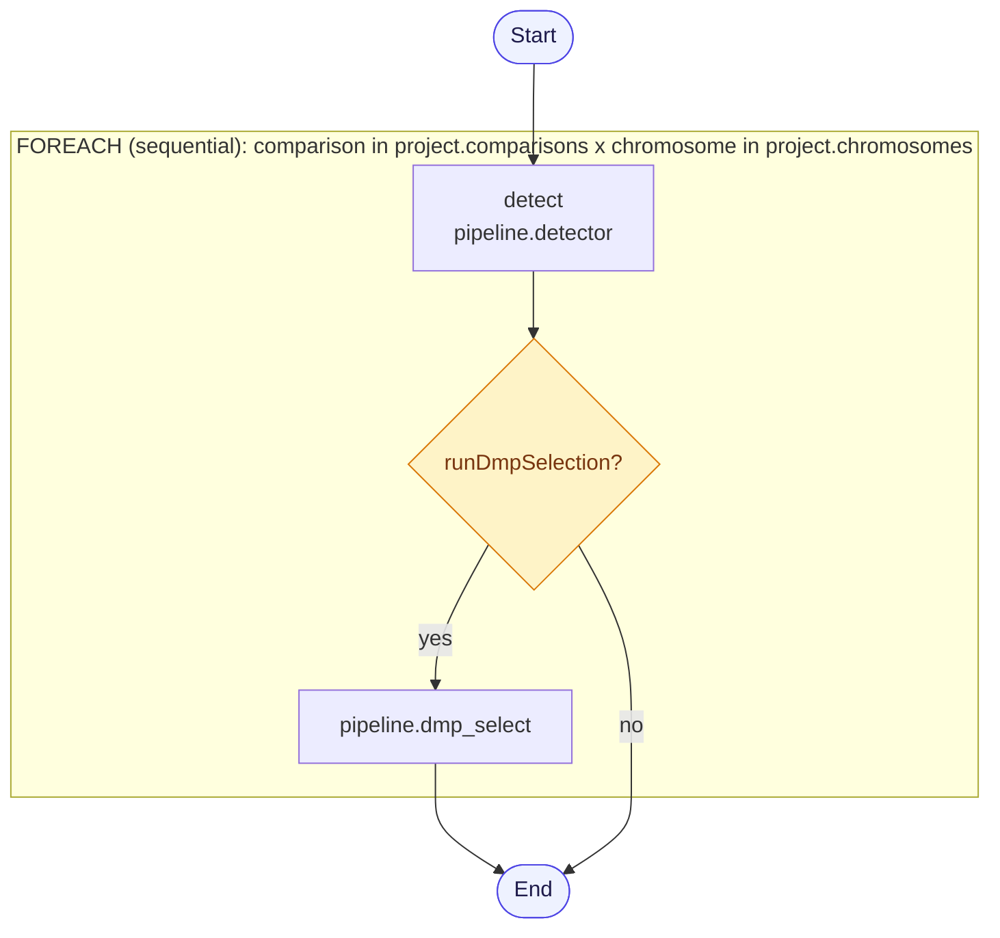
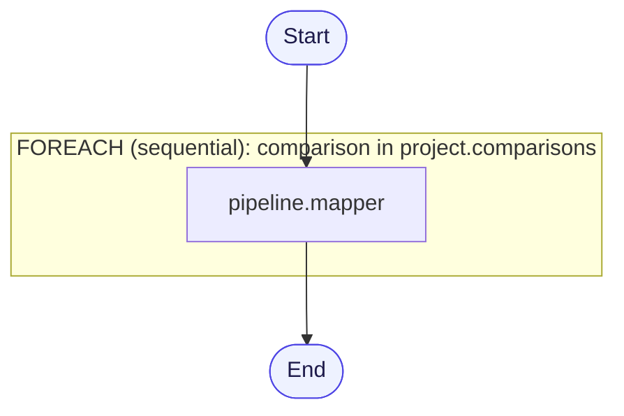
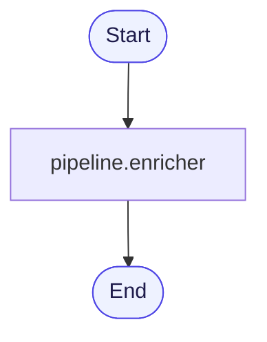
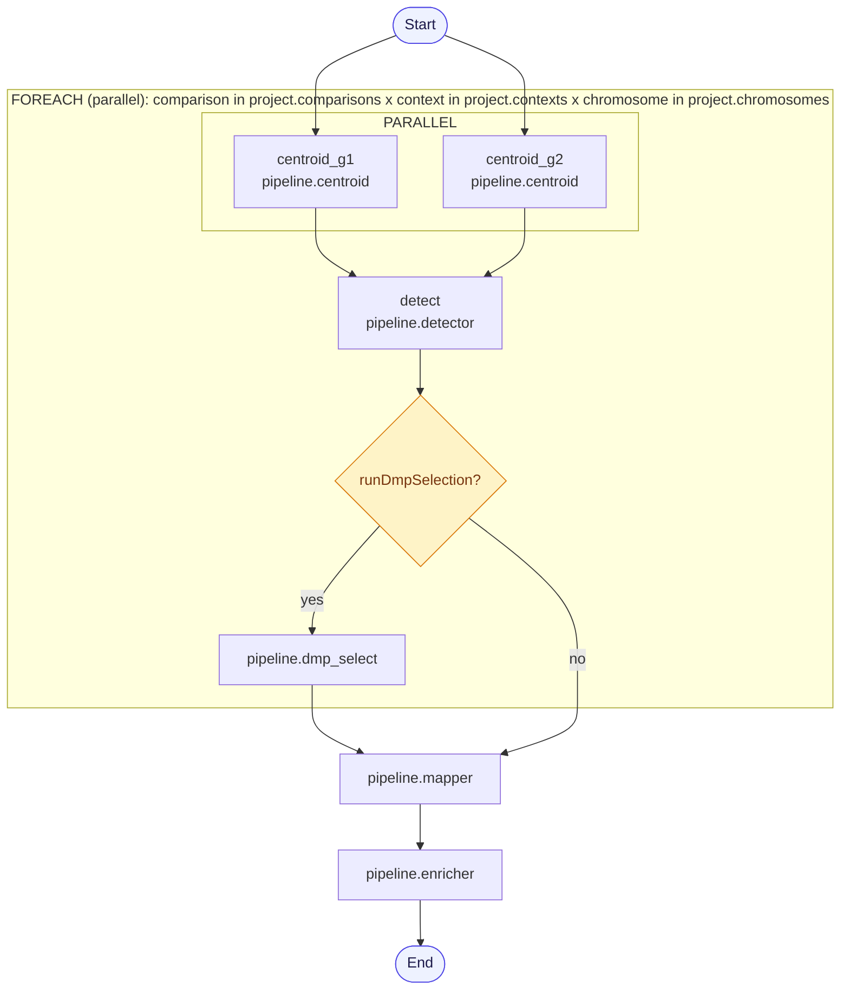
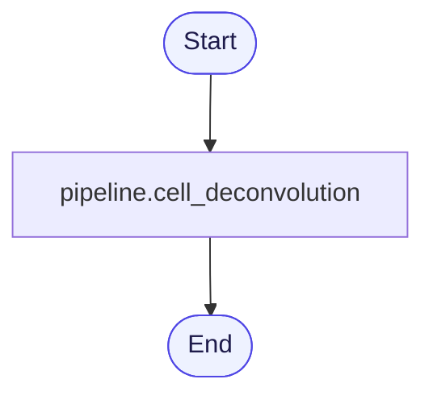
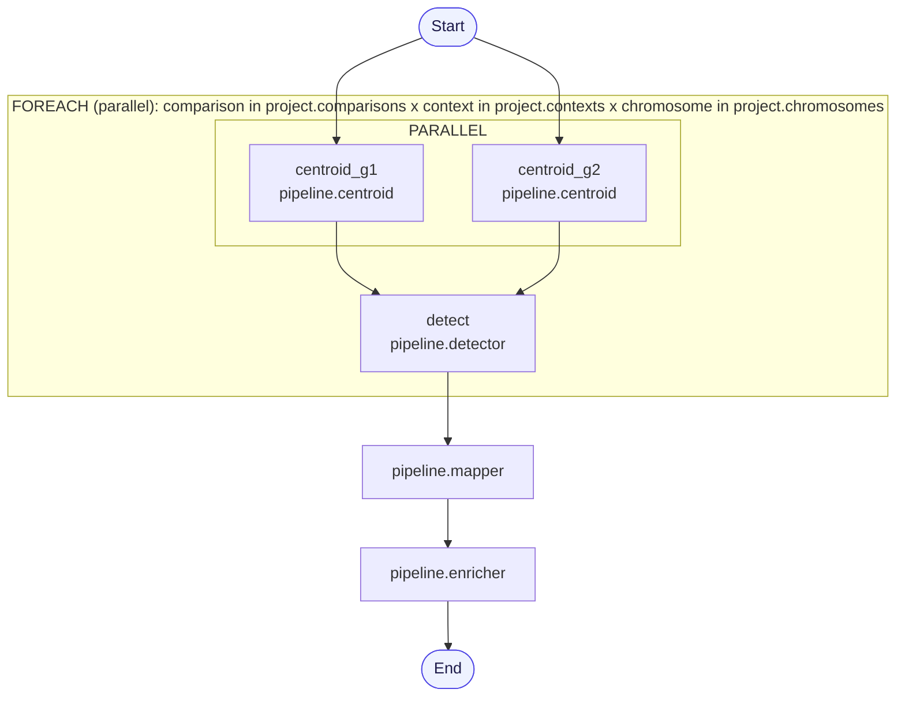

<!-- Generated by scripts/generate_domain_program_diagrams.py. Do not edit by hand. -->

# Detection, mapping, and interpretation

Single-pass comparison, differential detection, gene mapping, enrichment, deconvolution, and historical layout programs.

Back to [DomainProgram catalog](index.md).

## Contents

- [DataDriven](#datadriven) (`data_driven.program.json`)
- [DataDriven_Smoke](#datadriven_smoke) (`data_driven_smoke.program.json`)
- [TwoGroupComparison](#twogroupcomparison) (`two_group_comparison.program.json`)
- [DetectionDiscoveryOnly](#detectiondiscoveryonly) (`detection_discovery_only.program.json`)
- [DmpSelectOptional](#dmpselectoptional) (`dmp_select_optional.program.json`)
- [MapperPerComparison](#mapperpercomparison) (`mapper_per_comparison.program.json`)
- [EnricherWithOverrides](#enricherwithoverrides) (`enricher_with_overrides.program.json`)
- [Interpretation](#interpretation) (`interpretation.program.json`)
- [Cell_Deconv](#cell_deconv) (`cell_deconv_tabular.program.json`)
- [LegacyDual](#legacydual) (`legacy_dual.program.json`)

---

## DataDriven

Data-driven two-group comparison DomainProgram (detector → mapper → enricher).

- **Fixture:** `workflow_engine/domain/fixtures/data_driven.program.json` (v2)
- **Steps:** 5 executable step(s), 4 unique action(s)
- **Actions:** `pipeline.centroid`, `pipeline.detector`, `pipeline.mapper`, `pipeline.enricher`

---

## DataDriven_Smoke

Smoke data-driven two-group DomainProgram for CI.

- **Fixture:** `workflow_engine/domain/fixtures/data_driven_smoke.program.json` (v2)
- **Steps:** 5 executable step(s), 4 unique action(s)
- **Actions:** `pipeline.centroid`, `pipeline.detector`, `pipeline.mapper`, `pipeline.enricher`

---

## TwoGroupComparison

Control vs disease: centroids and detector per comparison, context, and chromosome.

- **Fixture:** `workflow_engine/domain/fixtures/two_group_comparison.program.json` (v2)
- **Steps:** 3 executable step(s), 2 unique action(s)
- **Actions:** `pipeline.centroid`, `pipeline.detector`

---

## DetectionDiscoveryOnly

Centroids and discovery-only methyl-detector per comparison×context×chromosome.

- **Fixture:** `workflow_engine/domain/fixtures/detection_discovery_only.program.json` (v2)
- **Steps:** 3 executable step(s), 2 unique action(s)
- **Actions:** `pipeline.centroid`, `pipeline.detector`

---

## DmpSelectOptional

Discovery detector with optional pipeline.dmp_select controlled by ${runDmpSelection}.

- **Fixture:** `workflow_engine/domain/fixtures/dmp_select_optional.program.json` (v2)
- **Steps:** 2 executable step(s), 2 unique action(s)
- **Actions:** `pipeline.detector`, `pipeline.dmp_select`

---

## MapperPerComparison

Map discovery DMPs to genes per comparison (assumes detection artifacts exist).

- **Fixture:** `workflow_engine/domain/fixtures/mapper_per_comparison.program.json` (v2)
- **Steps:** 1 executable step(s), 1 unique action(s)
- **Actions:** `pipeline.mapper`

---

## EnricherWithOverrides

Enricher with optional stepOverride for disease filter tuning.

- **Fixture:** `workflow_engine/domain/fixtures/enricher_with_overrides.program.json` (v2)
- **Steps:** 1 executable step(s), 1 unique action(s)
- **Actions:** `pipeline.enricher`

---

## Interpretation

Single-run interpretation: discovery detector, mapper, enricher (no MC).

- **Fixture:** `workflow_engine/domain/fixtures/interpretation.program.json` (v2)
- **Steps:** 6 executable step(s), 5 unique action(s)
- **Actions:** `pipeline.centroid`, `pipeline.detector`, `pipeline.dmp_select`, `pipeline.mapper`, `pipeline.enricher`

---

## Cell_Deconv

Buffy-coat leukocyte composition: Houseman/FlowSorted pipeline.cell_deconvolution → cell_fractions.csv (six Ω). Pair with tabular model_mc via profile covariates_path (Ω + clinical).

- **Fixture:** `workflow_engine/domain/fixtures/cell_deconv_tabular.program.json` (v2)
- **Steps:** 1 executable step(s), 1 unique action(s)
- **Actions:** `pipeline.cell_deconvolution`

---

## LegacyDual

Legacy dual-axis DomainProgram layout (historical).

- **Fixture:** `workflow_engine/domain/fixtures/legacy_dual.program.json` (v2)
- **Steps:** 5 executable step(s), 4 unique action(s)
- **Actions:** `pipeline.centroid`, `pipeline.detector`, `pipeline.mapper`, `pipeline.enricher`

