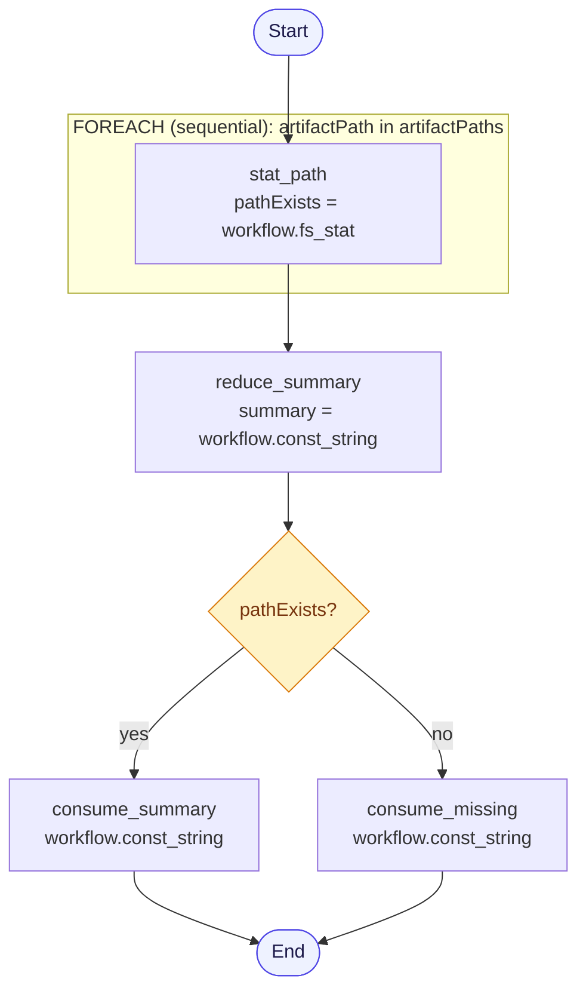
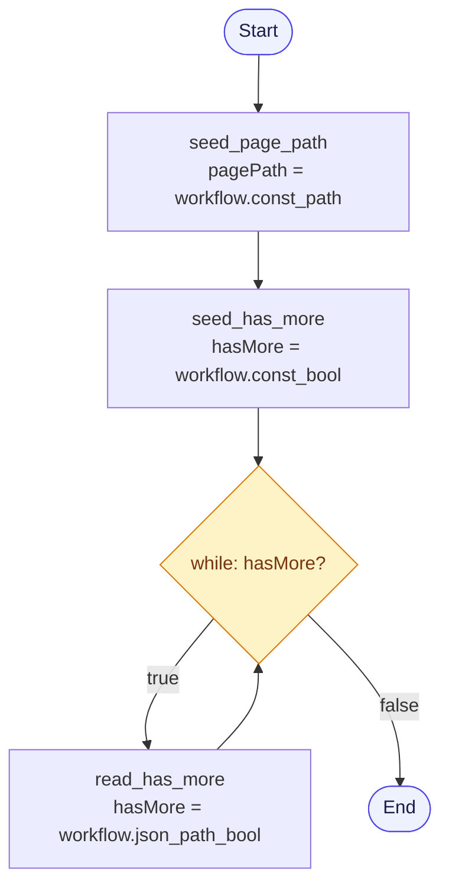
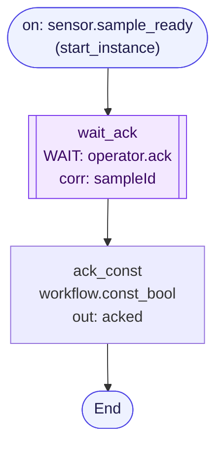

<!-- Generated by scripts/generate_domain_program_diagrams.py. Do not edit by hand. -->

# Engine control-flow and event fixtures

Generic DomainProgram fixtures exercising typed variable assignments, WHILE loops, and event-driven triggers / WAIT_EVENT nodes.

Back to [DomainProgram catalog](index.md).

## Contents

- [AssignMapReduce](#assignmapreduce) (`assign_map_reduce.program.json`)
- [AssignWhilePagination](#assignwhilepagination) (`assign_while_pagination.program.json`)
- [event_wait_ack](#event_wait_ack) (`event_wait_ack.program.json`)

---

## AssignMapReduce

Sequential map (fs_stat) then reduce into a typed summary string (generic fixture).

- **Fixture:** `workflow_engine/domain/fixtures/assign_map_reduce.program.json` (v2)
- **Steps:** 4 executable step(s), 2 unique action(s)
- **Declared variables:** `artifactPaths`, `pathExists`, `summary`
- **Actions:** `workflow.fs_stat`, `workflow.const_string`

---

## AssignWhilePagination

Generic pagination sketch: typed assign + WHILE (not a production methylation program).

- **Fixture:** `workflow_engine/domain/fixtures/assign_while_pagination.program.json` (v2)
- **Steps:** 3 executable step(s), 3 unique action(s)
- **Declared variables:** `hasMore`, `pagePath`
- **Actions:** `workflow.const_path`, `workflow.const_bool`, `workflow.json_path_bool`

---

## event_wait_ack

Fixture: start on sensor.sample_ready, park until operator.ack, then const_bool.

- **Fixture:** `workflow_engine/domain/fixtures/event_wait_ack.program.json` (v2)
- **Steps:** 2 executable step(s), 1 unique action(s)
- **Event triggers:** `sensor.sample_ready (start_instance)`
- **Actions:** `workflow.const_bool`

