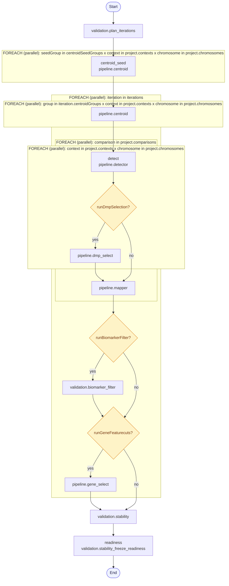
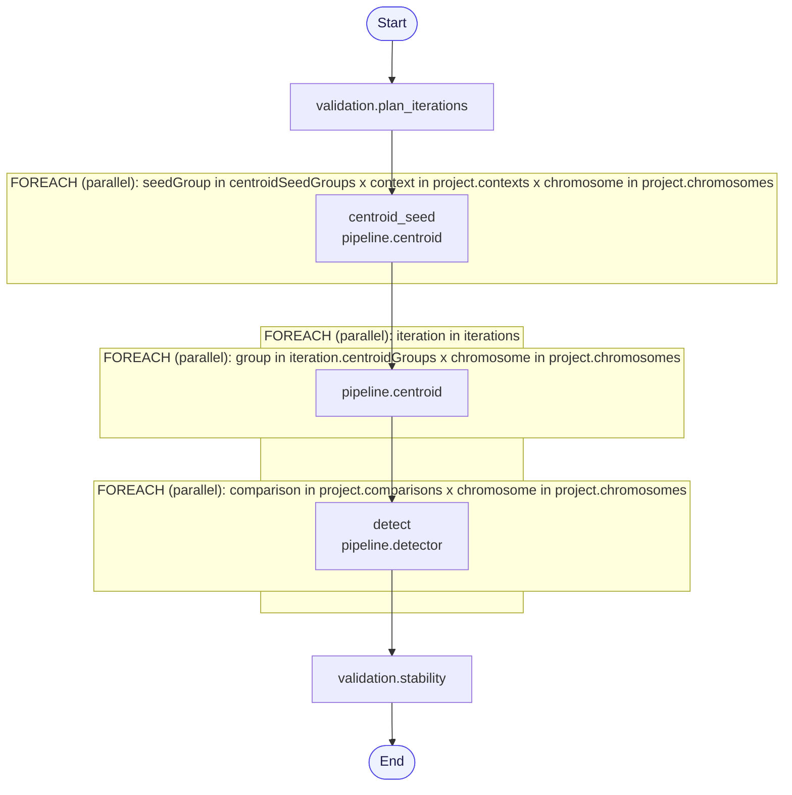
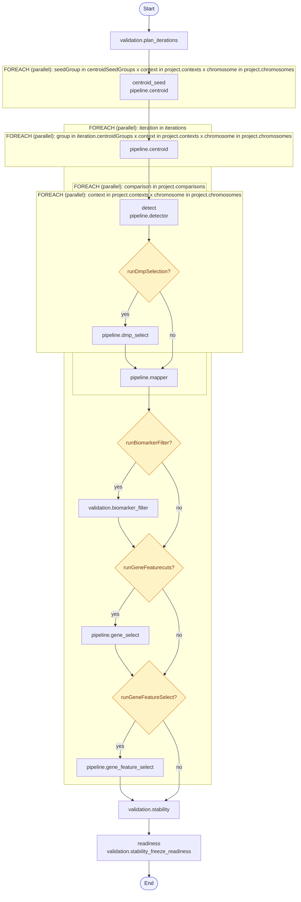
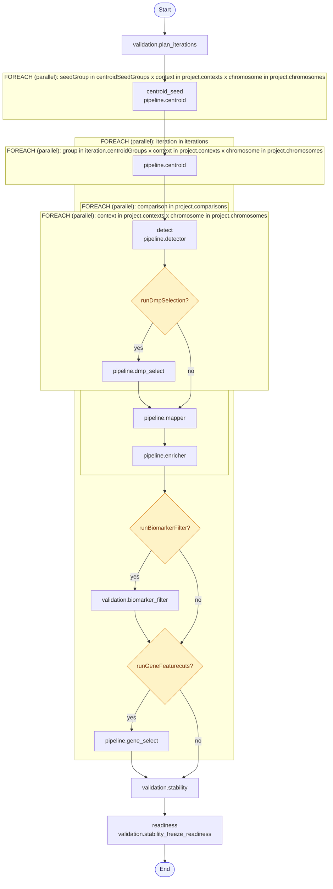
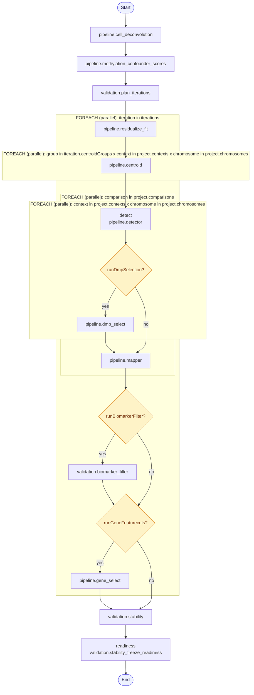
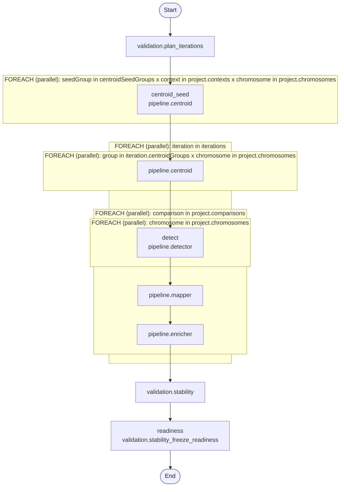

<!-- Generated by scripts/generate_domain_program_diagrams.py. Do not edit by hand. -->

# Monte Carlo stability

Repeated Monte Carlo resampling workflows for centroid seeding, differential detection, optional feature selection, and freeze-readiness evaluation.

Back to [DomainProgram catalog](index.md).

## Contents

- [MC_Stability](#mc_stability) (`mc_stability.program.json`)
- [MC_Stability_Smoke](#mc_stability_smoke) (`mc_stability_smoke.program.json`)
- [MC_Stability_Staged](#mc_stability_staged) (`mc_stability_staged.program.json`)
- [MC_Stability_PPI](#mc_stability_ppi) (`mc_stability_ppi.program.json`)
- [MC_Stability_Residual](#mc_stability_residual) (`mc_stability_residual.program.json`)
- [MC_Gene_Enricher_Stability](#mc_gene_enricher_stability) (`mc_gene_enricher_stability.program.json`)

---

## MC_Stability

Monte Carlo stability: plan iterations, parallel centroid seed, detector, optional dmp_select / biomarker filter / gene FeatureCuts, stability + freeze readiness.

- **Fixture:** `workflow_engine/domain/fixtures/mc_stability.program.json` (v2)
- **Steps:** 10 executable step(s), 9 unique action(s)
- **Actions:** `validation.plan_iterations`, `pipeline.centroid`, `pipeline.detector`, `pipeline.dmp_select`, `pipeline.mapper`, `validation.biomarker_filter`, `pipeline.gene_select`, `validation.stability`, `validation.stability_freeze_readiness`

---

## MC_Stability_Smoke

Smoke Monte Carlo stability DomainProgram for CI / compile checks.

- **Fixture:** `workflow_engine/domain/fixtures/mc_stability_smoke.program.json` (v2)
- **Steps:** 5 executable step(s), 4 unique action(s)
- **Actions:** `validation.plan_iterations`, `pipeline.centroid`, `pipeline.detector`, `validation.stability`

---

## MC_Stability_Staged

Staged / one-vs-rest Monte Carlo stability (includes optional gene_feature_select).

- **Fixture:** `workflow_engine/domain/fixtures/mc_stability_staged.program.json` (v2)
- **Steps:** 11 executable step(s), 10 unique action(s)
- **Actions:** `validation.plan_iterations`, `pipeline.centroid`, `pipeline.detector`, `pipeline.dmp_select`, `pipeline.mapper`, `validation.biomarker_filter`, `pipeline.gene_select`, `pipeline.gene_feature_select`, `validation.stability`, `validation.stability_freeze_readiness`

---

## MC_Stability_PPI

Monte Carlo stability with PPI/STRING enricher defaults (same topology as MC_Stability).

- **Fixture:** `workflow_engine/domain/fixtures/mc_stability_ppi.program.json` (v2)
- **Steps:** 11 executable step(s), 10 unique action(s)
- **Actions:** `validation.plan_iterations`, `pipeline.centroid`, `pipeline.detector`, `pipeline.dmp_select`, `pipeline.mapper`, `pipeline.enricher`, `validation.biomarker_filter`, `pipeline.gene_select`, `validation.stability`, `validation.stability_freeze_readiness`

---

## MC_Stability_Residual

Monte Carlo stability with train-only M-value residualization. Deconv + confounder scores once; residualize_fit per iteration on train IDs. Does not change shipped mc_stability.

- **Fixture:** `workflow_engine/domain/fixtures/mc_stability_residual.program.json` (v2)
- **Steps:** 12 executable step(s), 12 unique action(s)
- **Actions:** `pipeline.cell_deconvolution`, `pipeline.methylation_confounder_scores`, `validation.plan_iterations`, `pipeline.residualize_fit`, `pipeline.centroid`, `pipeline.detector`, `pipeline.dmp_select`, `pipeline.mapper`, `validation.biomarker_filter`, `pipeline.gene_select`, `validation.stability`, `validation.stability_freeze_readiness`

---

## MC_Gene_Enricher_Stability

Monte Carlo stability focused on enricher gene recurrence (no dmp_select / gene FeatureCuts).

- **Fixture:** `workflow_engine/domain/fixtures/mc_gene_enricher_stability.program.json` (v2)
- **Steps:** 8 executable step(s), 7 unique action(s)
- **Actions:** `validation.plan_iterations`, `pipeline.centroid`, `pipeline.detector`, `pipeline.mapper`, `pipeline.enricher`, `validation.stability`, `validation.stability_freeze_readiness`

