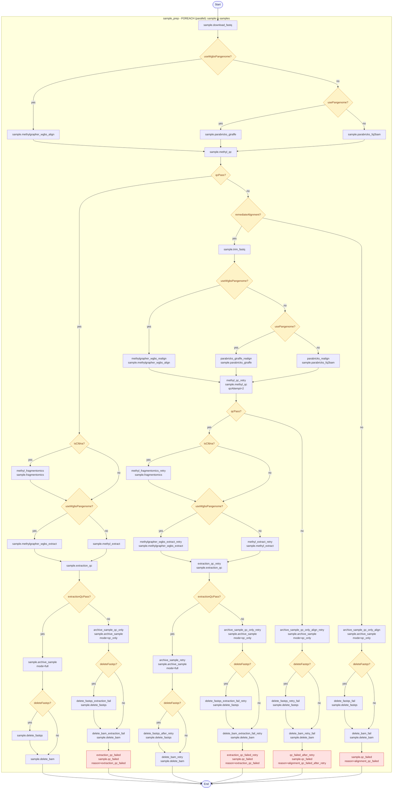
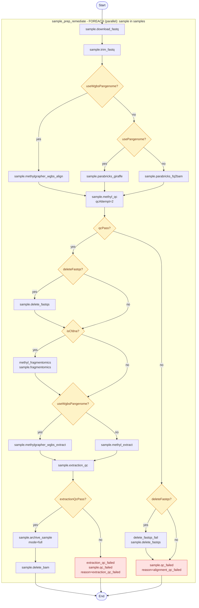
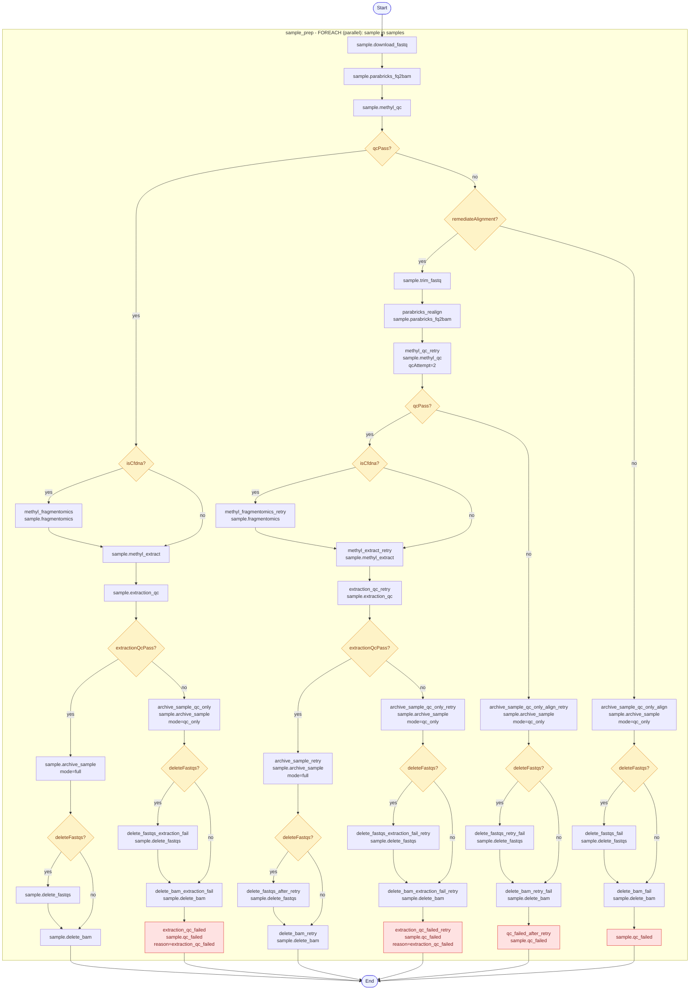
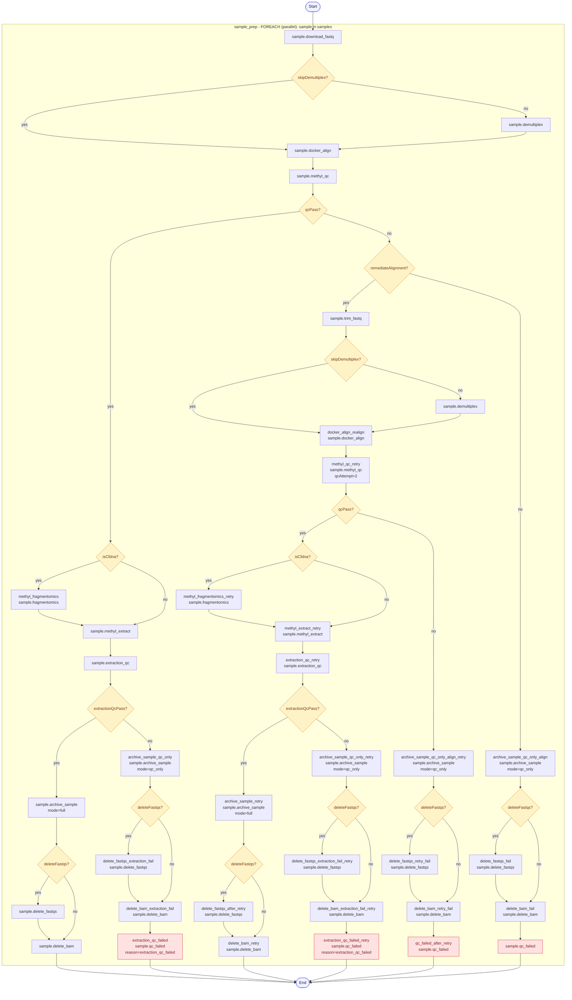
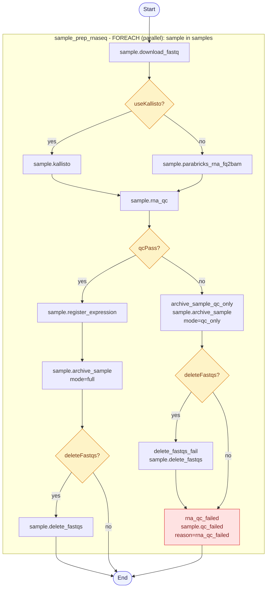
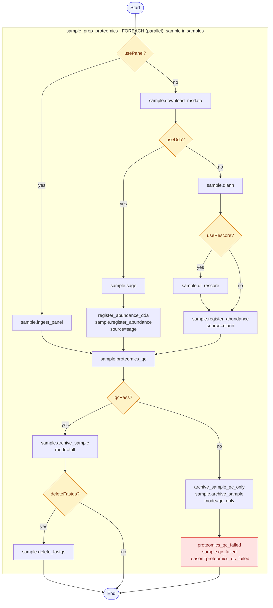

<!-- Generated by scripts/generate_domain_program_diagrams.py. Do not edit by hand. -->

# Sample preparation

Per-sample upstream preprocessing programs turning raw sequencing reads or mass-spectrometry/panel inputs into QC-gated analysis matrices.

Back to [DomainProgram catalog](index.md).

## Contents

- [SamplePrepPipeline](#samplepreppipeline) (`sample_prep.program.json`)
- [SamplePrepRemediationPipeline](#sampleprepremediationpipeline) (`sample_prep_remediate.program.json`)
- [SamplePrepEmseqTargetedPipeline](#sampleprepemseqtargetedpipeline) (`sample_prep_emseq.program.json`)
- [SamplePrepEpiGbsPipeline](#sampleprepepigbspipeline) (`sample_prep_epigbs.program.json`)
- [SamplePrepRnaSeqPipeline](#samplepreprnaseqpipeline) (`sample_prep_rnaseq.program.json`)
- [SamplePrepProteomicsPipeline](#sampleprepproteomicspipeline) (`sample_prep_proteomics.program.json`)

---

## SamplePrepPipeline

Per-sample upstream preprocessing with alignment QC screening, trim remediation, extraction QC, and sample archive. Gate booleans are typed DomainProgram variables (catalog scope_bindings write them; FOREACH+IF remains the control flow — hybrid typed assign, not science-in-assign). Align nodes set stageFastqs=local so the pinned worker stages FASTQs from the sample root (/work/samples/<id>/) straight into METHYL_LOCAL_TMP; the align leaf is not a second FASTQ copy. methylGrapher extract sets workDirMode=local (local scratch, publish *.h5/*.json to sampleDir).

- **Fixture:** `workflow_engine/domain/fixtures/sample_prep.program.json` (v2)
- **Steps:** 40 executable step(s), 14 unique action(s)
- **Declared variables:** `qcPass`, `remediateAlignment`, `extractionQcPass`, `sampleArchived`, `deleteFastqs`
- **Actions:** `sample.download_fastq`, `sample.methylgrapher_wgbs_align`, `sample.parabricks_giraffe`, `sample.parabricks_fq2bam`, `sample.methyl_qc`, `sample.fragmentomics`, `sample.methylgrapher_wgbs_extract`, `sample.methyl_extract`, `sample.extraction_qc`, `sample.archive_sample`, `sample.delete_fastqs`, `sample.delete_bam`, `sample.qc_failed`, `sample.trim_fastq`

---

## SamplePrepRemediationPipeline

Batch remediation: re-download FASTQs, R2 front-trim, realign, and final QC before extract. Typed gate variables document the QC bus (catalog bindings populate them).

- **Fixture:** `workflow_engine/domain/fixtures/sample_prep_remediate.program.json` (v2)
- **Steps:** 16 executable step(s), 14 unique action(s)
- **Declared variables:** `qcPass`, `extractionQcPass`, `deleteFastqs`
- **Actions:** `sample.download_fastq`, `sample.trim_fastq`, `sample.methylgrapher_wgbs_align`, `sample.parabricks_giraffe`, `sample.parabricks_fq2bam`, `sample.methyl_qc`, `sample.delete_fastqs`, `sample.fragmentomics`, `sample.methylgrapher_wgbs_extract`, `sample.methyl_extract`, `sample.extraction_qc`, `sample.archive_sample`, `sample.delete_bam`, `sample.qc_failed`

---

## SamplePrepEmseqTargetedPipeline

EM-Seq / hybrid-capture targeted methylation SamplePrep (inch-wide, mile-deep). Uses linear Parabricks WGBS alignment (libraryProtocol=emseq_targeted); methyl_extract reads actionConfig.methyl_extract.target_panel_bed and restricts the BAM via samtools -L before extraction. Depth floors come from elevated min_cov. Not epi-GBS and not genome-wide WGBS.

- **Fixture:** `workflow_engine/domain/fixtures/sample_prep_emseq.program.json` (v2)
- **Steps:** 34 executable step(s), 11 unique action(s)
- **Declared variables:** `qcPass`, `remediateAlignment`, `extractionQcPass`, `sampleArchived`, `deleteFastqs`
- **Actions:** `sample.download_fastq`, `sample.parabricks_fq2bam`, `sample.methyl_qc`, `sample.fragmentomics`, `sample.methyl_extract`, `sample.extraction_qc`, `sample.archive_sample`, `sample.delete_fastqs`, `sample.delete_bam`, `sample.qc_failed`, `sample.trim_fastq`

---

## SamplePrepEpiGbsPipeline

epi-GBS / reduced-representation methylation SamplePrep: optional barcode demultiplex, generic Docker align (not Parabricks), then methyl QC → extract → archive. Use libraryProtocol=epi_gbs. WGBS stays on SamplePrepPipeline (Parabricks).

- **Fixture:** `workflow_engine/domain/fixtures/sample_prep_epigbs.program.json` (v2)
- **Steps:** 36 executable step(s), 12 unique action(s)
- **Declared variables:** `qcPass`, `remediateAlignment`, `extractionQcPass`, `sampleArchived`, `deleteFastqs`, `skipDemultiplex`
- **Actions:** `sample.download_fastq`, `sample.demultiplex`, `sample.docker_align`, `sample.methyl_qc`, `sample.fragmentomics`, `sample.methyl_extract`, `sample.extraction_qc`, `sample.archive_sample`, `sample.delete_fastqs`, `sample.delete_bam`, `sample.qc_failed`, `sample.trim_fastq`

---

## SamplePrepRnaSeqPipeline

Per-sample RNA-Seq preprocessing: download FASTQ, quantify (STAR rna_fq2bam or kallisto, selected by ${useKallisto}), RNA QC gate, register a canonical expression.h5, then archive. Parallel to SamplePrepPipeline (WGBS) but produces gene expression instead of methylation HDF5.

- **Fixture:** `workflow_engine/domain/fixtures/sample_prep_rnaseq.program.json` (v2)
- **Steps:** 10 executable step(s), 8 unique action(s)
- **Declared variables:** `useKallisto`, `qcPass`, `deleteFastqs`
- **Actions:** `sample.download_fastq`, `sample.kallisto`, `sample.parabricks_rna_fq2bam`, `sample.rna_qc`, `sample.register_expression`, `sample.archive_sample`, `sample.delete_fastqs`, `sample.qc_failed`

---

## SamplePrepProteomicsPipeline

Per-sample proteomics preprocessing. Ingest selected by ${usePanel}: panel-matrix (Olink/SomaScan/open, CPU) vs DIA-NN GPU search (download -> diann -> optional Prosit rescore -> register_abundance). Then proteomics QC gate and archive. Parallel to SamplePrep(Rna) but produces protein abundances.

- **Fixture:** `workflow_engine/domain/fixtures/sample_prep_proteomics.program.json` (v2)
- **Steps:** 12 executable step(s), 10 unique action(s)
- **Declared variables:** `usePanel`, `useDda`, `useRescore`, `qcPass`, `deleteFastqs`
- **Actions:** `sample.ingest_panel`, `sample.download_msdata`, `sample.sage`, `sample.register_abundance`, `sample.diann`, `sample.dl_rescore`, `sample.proteomics_qc`, `sample.archive_sample`, `sample.delete_fastqs`, `sample.qc_failed`

