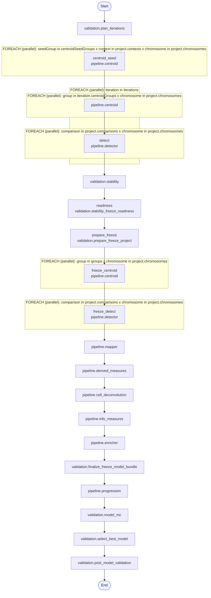
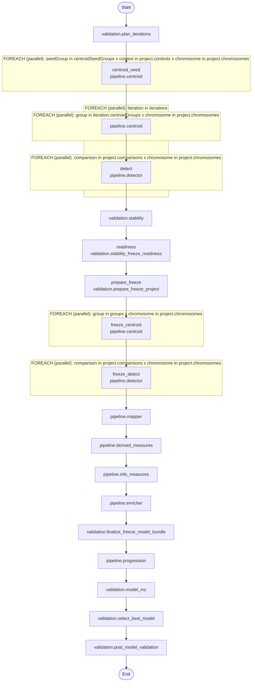
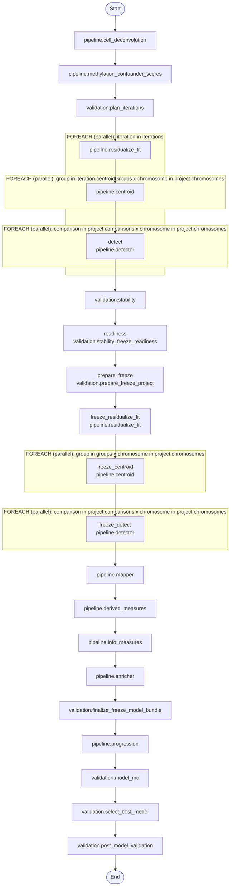
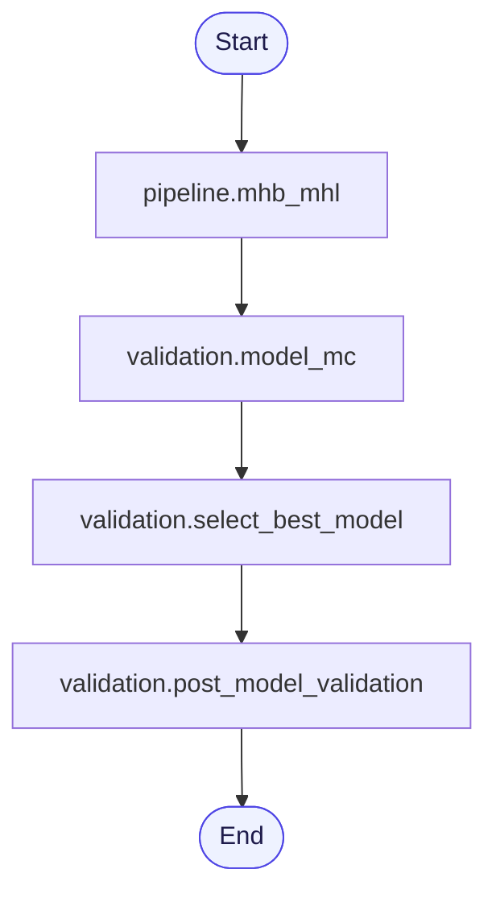
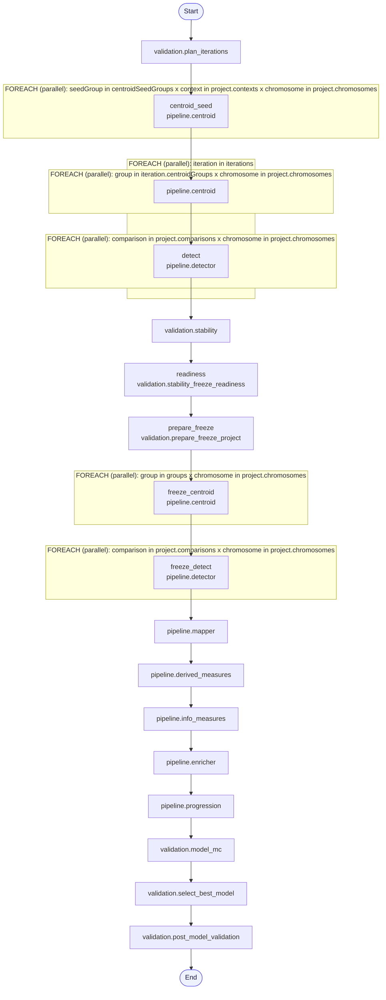
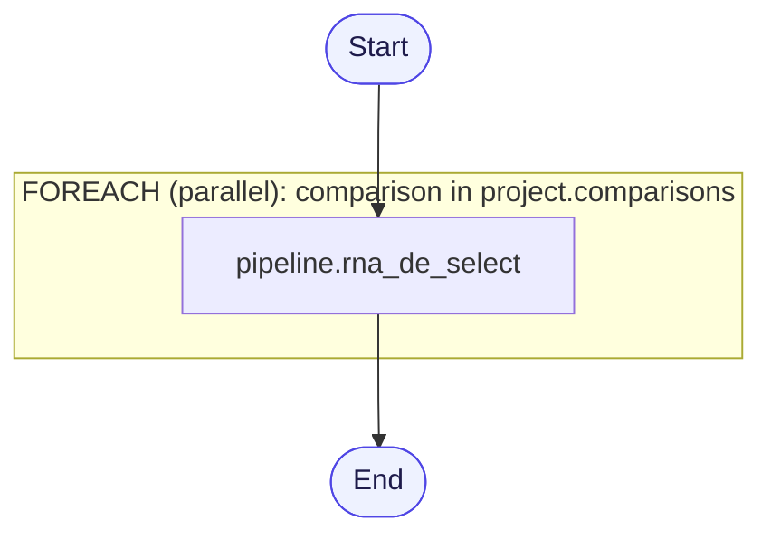
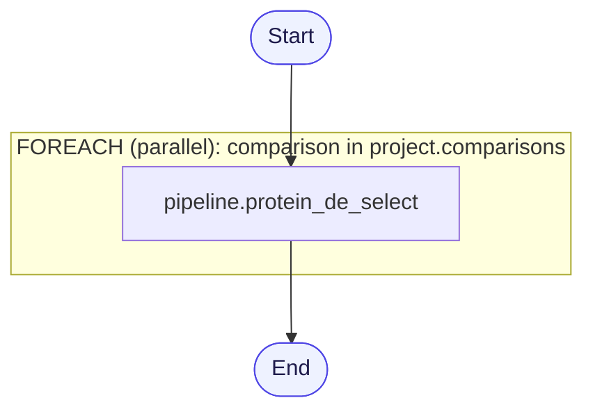
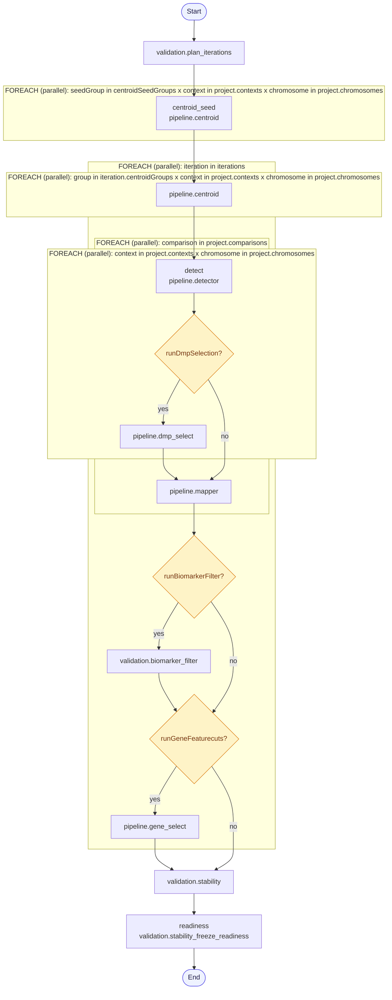
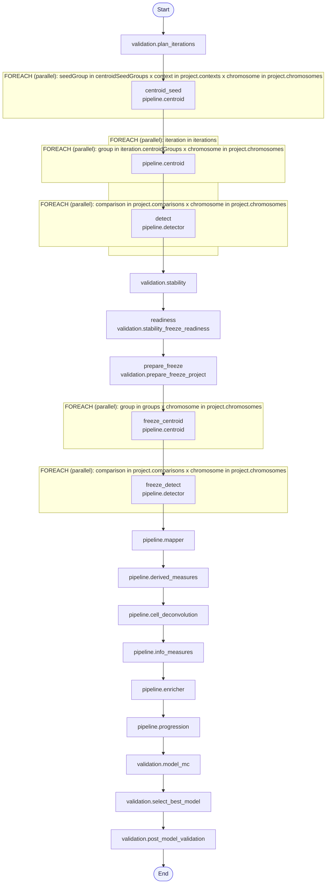

<!-- Generated by scripts/generate_domain_program_diagrams.py. Do not edit by hand. -->

# Study validation and SaMD lifecycles

End-to-end study validation, modality lifecycle, and SaMD tier entry-point programs spanning stability, panel freeze, model selection, and hold-out evaluation.

Back to [DomainProgram catalog](index.md).

## Contents

- [FullLifecycle](#fulllifecycle) (`full_lifecycle.program.json`)
- [StudyValidationLifecycle](#studyvalidationlifecycle) (`study_validation_lifecycle.program.json`)
- [StudyValidationLifecycleNoDeconv](#studyvalidationlifecyclenodeconv) (`study_validation_lifecycle_no_deconv.program.json`)
- [StudyValidationLifecycleResidual](#studyvalidationlifecycleresidual) (`study_validation_lifecycle_residual.program.json`)
- [StudyValidationMhlSurvival](#studyvalidationmhlsurvival) (`study_validation_mhl_survival.program.json`)
- [PlantStressStudyLifecycle](#plantstressstudylifecycle) (`plant_stress_study_lifecycle.program.json`)
- [PlantStressStudyLifecycleWithDeconv](#plantstressstudylifecyclewithdeconv) (`plant_stress_study_lifecycle_with_deconv.program.json`)
- [RnaSeqStudyLifecycle](#rnaseqstudylifecycle) (`rnaseq_study_lifecycle.program.json`)
- [ProteomicsStudyLifecycle](#proteomicsstudylifecycle) (`proteomics_study_lifecycle.program.json`)
- [SaMD_Research](#samd_research) (`samd_research.program.json`)
- [SaMD_Holdout_Enrichment](#samd_holdout_enrichment) (`samd_holdout_enrichment.program.json`)
- [SaMD_Pivotal](#samd_pivotal) (`samd_pivotal.program.json`)

---

## FullLifecycle

Full validation lifecycle: MC stability → freeze → model.

- **Fixture:** `workflow_engine/domain/fixtures/full_lifecycle.program.json` (v2)
- **Steps:** 18 executable step(s), 15 unique action(s)
- **Actions:** `validation.plan_iterations`, `pipeline.centroid`, `pipeline.detector`, `validation.stability`, `validation.stability_freeze_readiness`, `validation.prepare_freeze_project`, `pipeline.mapper`, `pipeline.derived_measures`, `pipeline.cell_deconvolution`, `pipeline.info_measures`, `pipeline.enricher`, `pipeline.progression`, `validation.model_mc`, `validation.select_best_model`, `validation.post_model_validation`

---

## StudyValidationLifecycle

Study validation lifecycle: freeze readiness → freeze → model (post-MC).

- **Fixture:** `workflow_engine/domain/fixtures/study_validation_lifecycle.program.json` (v2)
- **Steps:** 19 executable step(s), 16 unique action(s)
- **Actions:** `validation.plan_iterations`, `pipeline.centroid`, `pipeline.detector`, `validation.stability`, `validation.stability_freeze_readiness`, `validation.prepare_freeze_project`, `pipeline.mapper`, `pipeline.derived_measures`, `pipeline.cell_deconvolution`, `pipeline.info_measures`, `pipeline.enricher`, `validation.finalize_freeze_model_bundle`, `pipeline.progression`, `validation.model_mc`, `validation.select_best_model`, `validation.post_model_validation`

---

## StudyValidationLifecycleNoDeconv

Study validation lifecycle without blood cell-type deconvolution. Same freeze→mapper→derived→info_measures→enricher→model path as StudyValidationLifecycle, omitting the deconvolution node. Used by cfDNA WGBS plasma and EM-Seq targeted assay procedure packs.

- **Fixture:** `workflow_engine/domain/fixtures/study_validation_lifecycle_no_deconv.program.json` (v2)
- **Steps:** 18 executable step(s), 15 unique action(s)
- **Actions:** `validation.plan_iterations`, `pipeline.centroid`, `pipeline.detector`, `validation.stability`, `validation.stability_freeze_readiness`, `validation.prepare_freeze_project`, `pipeline.mapper`, `pipeline.derived_measures`, `pipeline.info_measures`, `pipeline.enricher`, `validation.finalize_freeze_model_bundle`, `pipeline.progression`, `validation.model_mc`, `validation.select_best_model`, `validation.post_model_validation`

---

## StudyValidationLifecycleResidual

Study validation lifecycle with train-only M-value residualization: deconv+scores before MC, residualize_fit per iteration and at freeze. Does not change shipped study_validation_lifecycle.

- **Fixture:** `workflow_engine/domain/fixtures/study_validation_lifecycle_residual.program.json` (v2)
- **Steps:** 21 executable step(s), 18 unique action(s)
- **Actions:** `pipeline.cell_deconvolution`, `pipeline.methylation_confounder_scores`, `validation.plan_iterations`, `pipeline.residualize_fit`, `pipeline.centroid`, `pipeline.detector`, `validation.stability`, `validation.stability_freeze_readiness`, `validation.prepare_freeze_project`, `pipeline.mapper`, `pipeline.derived_measures`, `pipeline.info_measures`, `pipeline.enricher`, `validation.finalize_freeze_model_bundle`, `pipeline.progression`, `validation.model_mc`, `validation.select_best_model`, `validation.post_model_validation`

---

## StudyValidationMhlSurvival

EM-Seq MHL + Cox survival lifecycle. SamplePrep is the EM-Seq program; this body is MHB/MHL then model-MC (cox backend). No genome-wide centroid DMP hunt.

- **Fixture:** `workflow_engine/domain/fixtures/study_validation_mhl_survival.program.json` (v2)
- **Steps:** 4 executable step(s), 4 unique action(s)
- **Actions:** `pipeline.mhb_mhl`, `validation.model_mc`, `validation.select_best_model`, `validation.post_model_validation`

---

## PlantStressStudyLifecycle

Plant abiotic stress methylation lifecycle: freeze readiness → freeze → model (post-MC). Same science as StudyValidationLifecycle but without blood cell deconvolution (no plant cell-type basis); progression is config-gated off for binary Control vs Stress studies.

- **Fixture:** `workflow_engine/domain/fixtures/plant_stress_study_lifecycle.program.json` (v2)
- **Steps:** 17 executable step(s), 14 unique action(s)
- **Actions:** `validation.plan_iterations`, `pipeline.centroid`, `pipeline.detector`, `validation.stability`, `validation.stability_freeze_readiness`, `validation.prepare_freeze_project`, `pipeline.mapper`, `pipeline.derived_measures`, `pipeline.info_measures`, `pipeline.enricher`, `pipeline.progression`, `validation.model_mc`, `validation.select_best_model`, `validation.post_model_validation`

---

## PlantStressStudyLifecycleWithDeconv

Plant abiotic stress methylation lifecycle with cell deconvolution. Requires operator-supplied plant atlas via actionConfig.cell_deconvolution seed_basis_path or hierarchy_basis_path (no blood fallback).

- **Fixture:** `workflow_engine/domain/fixtures/plant_stress_study_lifecycle_with_deconv.program.json` (v2)
- **Steps:** 18 executable step(s), 15 unique action(s)
- **Actions:** `validation.plan_iterations`, `pipeline.centroid`, `pipeline.detector`, `validation.stability`, `validation.stability_freeze_readiness`, `validation.prepare_freeze_project`, `pipeline.mapper`, `pipeline.derived_measures`, `pipeline.cell_deconvolution`, `pipeline.info_measures`, `pipeline.enricher`, `pipeline.progression`, `validation.model_mc`, `validation.select_best_model`, `validation.post_model_validation`

---

## RnaSeqStudyLifecycle

RNA-Seq study modeling: per-comparison differential-expression gene panel selection + tabular classification (pipeline.rna_de_select). RNA analogue of the methylation centroid/detector study path; reuses the same scheduler and CAAS. outputDir is bound per instance via ${var.rnaDeOutputDir}.

- **Fixture:** `workflow_engine/domain/fixtures/rnaseq_study_lifecycle.program.json` (v2)
- **Steps:** 1 executable step(s), 1 unique action(s)
- **Declared variables:** `rnaDeOutputDir`
- **Actions:** `pipeline.rna_de_select`

---

## ProteomicsStudyLifecycle

Proteomics study modeling: per-comparison differential-abundance protein panel selection + tabular classification (pipeline.protein_de_select). Reuses the shared samples-x-features seam, scheduler, and CAAS. outputDir is bound per instance via ${var.proteinDeOutputDir}.

- **Fixture:** `workflow_engine/domain/fixtures/proteomics_study_lifecycle.program.json` (v2)
- **Steps:** 1 executable step(s), 1 unique action(s)
- **Declared variables:** `proteinDeOutputDir`
- **Actions:** `pipeline.protein_de_select`

---

## SaMD_Research

SaMD research-tier entry point (MC stability topology). Set pipelineProfile=samd_research and projectPath in context.

- **Fixture:** `workflow_engine/domain/fixtures/samd_research.program.json` (v2)
- **Steps:** 10 executable step(s), 9 unique action(s)
- **Actions:** `validation.plan_iterations`, `pipeline.centroid`, `pipeline.detector`, `pipeline.dmp_select`, `pipeline.mapper`, `validation.biomarker_filter`, `pipeline.gene_select`, `validation.stability`, `validation.stability_freeze_readiness`

---

## SaMD_Holdout_Enrichment

SaMD holdout-enrichment entry point (MC stability topology). Set pipelineProfile=samd_holdout_enrichment and projectPath in context.

- **Fixture:** `workflow_engine/domain/fixtures/samd_holdout_enrichment.program.json` (v2)
- **Steps:** 10 executable step(s), 9 unique action(s)
- **Actions:** `validation.plan_iterations`, `pipeline.centroid`, `pipeline.detector`, `pipeline.dmp_select`, `pipeline.mapper`, `validation.biomarker_filter`, `pipeline.gene_select`, `validation.stability`, `validation.stability_freeze_readiness`

---

## SaMD_Pivotal

SaMD pivotal-tier entry point (study validation lifecycle topology). Set pipelineProfile=samd_pivotal and projectPath in context.

- **Fixture:** `workflow_engine/domain/fixtures/samd_pivotal.program.json` (v2)
- **Steps:** 18 executable step(s), 15 unique action(s)
- **Actions:** `validation.plan_iterations`, `pipeline.centroid`, `pipeline.detector`, `validation.stability`, `validation.stability_freeze_readiness`, `validation.prepare_freeze_project`, `pipeline.mapper`, `pipeline.derived_measures`, `pipeline.cell_deconvolution`, `pipeline.info_measures`, `pipeline.enricher`, `pipeline.progression`, `validation.model_mc`, `validation.select_best_model`, `validation.post_model_validation`

