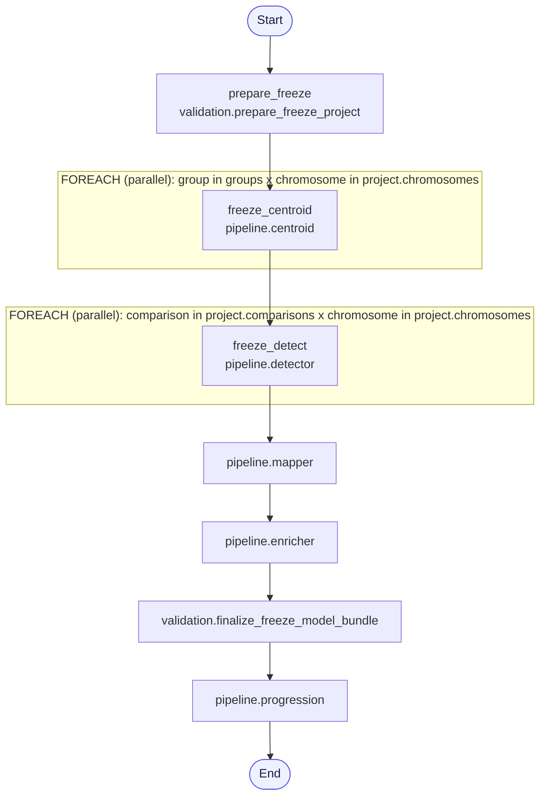
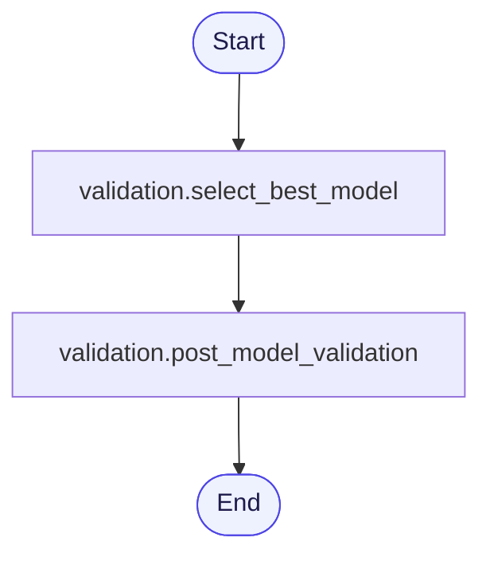
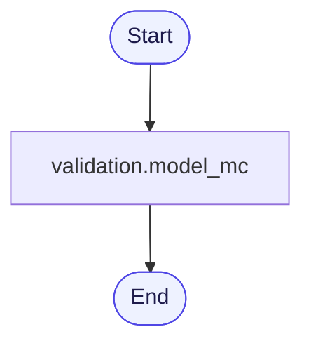

<!-- Generated by scripts/generate_domain_program_diagrams.py. Do not edit by hand. -->

# Validation freeze and model building

Post-stability stage programs for panel freezing, production model locking, and model-selection Monte Carlo runs.

Back to [DomainProgram catalog](index.md).

## Contents

- [ValidationFreeze](#validationfreeze) (`validation_freeze.program.json`)
- [ValidationModel](#validationmodel) (`validation_model.program.json`)
- [ValidationModelMc](#validationmodelmc) (`validation_model_mc.program.json`)
- [ValidationModelMcRebuild](#validationmodelmcrebuild) (`validation_model_mc_rebuild.program.json`)

---

## ValidationFreeze

Freeze stable panels / readiness after MC stability.

- **Fixture:** `workflow_engine/domain/fixtures/validation_freeze.program.json` (v2)
- **Steps:** 7 executable step(s), 7 unique action(s)
- **Actions:** `validation.prepare_freeze_project`, `pipeline.centroid`, `pipeline.detector`, `pipeline.mapper`, `pipeline.enricher`, `validation.finalize_freeze_model_bundle`, `pipeline.progression`

---

## ValidationModel

Lock production model from frozen stability artifacts. With a single enabled backend (e.g. ecdf), builds production directly; with multiple backends, requires prior validation.model_mc metrics.

- **Fixture:** `workflow_engine/domain/fixtures/validation_model.program.json` (v2)
- **Steps:** 2 executable step(s), 2 unique action(s)
- **Actions:** `validation.select_best_model`, `validation.post_model_validation`

---

## ValidationModelMc

Run model-selection Monte Carlo only, strictly reusing existing primary MC centroid and detector artifacts.

- **Fixture:** `workflow_engine/domain/fixtures/validation_model_mc.program.json` (v2)
- **Steps:** 1 executable step(s), 1 unique action(s)
- **Actions:** `validation.model_mc`

---

## ValidationModelMcRebuild

Model-MC after discovery-only stability + fixed-panel freeze: rebuild shared centroid/detector under the frozen panel (strict primary-MC reuse is incompatible).

- **Fixture:** `workflow_engine/domain/fixtures/validation_model_mc_rebuild.program.json` (v2)
- **Steps:** 1 executable step(s), 1 unique action(s)
- **Actions:** `validation.model_mc`

